# 秀吉招式素材審閱

角色：原版頭95%，雙手持刀，腰前金葫蘆扇收納。

招式格數與時長以人物本體為準；有獨立特效尾段的 GIF 會延長待機顯示，並於各招註明。循環接回起始姿勢的位移不等同遊戲角色瞬移。

## light_1

10 格 / 700 ms

前跨落地時雙手下切，肩背胸與重心隨刀往前下跟進，後腳跟上收勢。

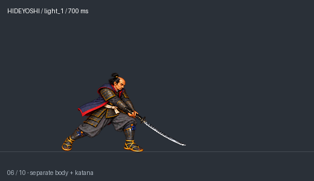

[遊戲速度動畫](actions/light_1/light_1_10.gif)

版本：downcut10_scale_registration_v6；狀態：candidate

## light_2

8 格 / 590 ms

雙手腰側蓄勢，前跨帶腰肩胸水平橫斬，側背隨刀旋轉後收勢。

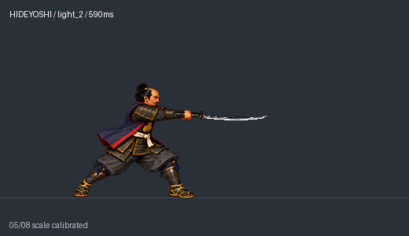

[遊戲速度動畫](actions/light_2/light_2.gif)

版本：horizontal_torso_turn_v4_scale_calibrated；狀態：candidate

## light_3

11 格 / 680 ms

第三段保持前跨與胸肩前向發力，實際下斬加速並壓低雙手握點與刀斬高度；命中擊飛後後腳跟進，總時長保持680ms。

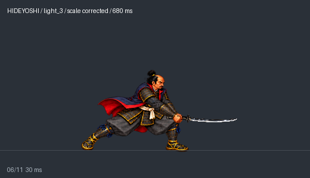

[遊戲速度動畫](actions/light_3_scale_v4/light_3_scale_v4.gif)

版本：fastlow_scale_corrected_v4；狀態：candidate

## heavy

12 格 / 950 ms

翻腕轉刃向上、前跨蓄勢，快速上撩擊飛；12格950ms，揮動段180ms。

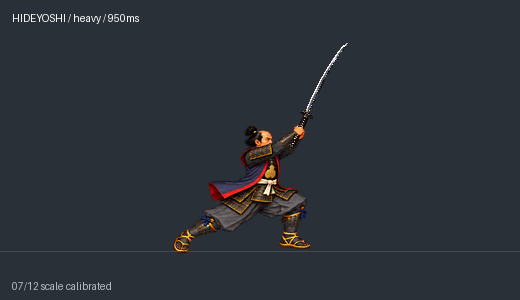

[遊戲速度動畫](actions/heavy_step12_v4/heavy_edgeup.gif)

版本：step12_fastswing_v5_scale_calibrated；狀態：candidate

## charge_ready

6 格 / 680 ms

雙手近身收刀，雙腳逐步開馬步下沉；腰前金扇收納，刀留在腰側安全位置。

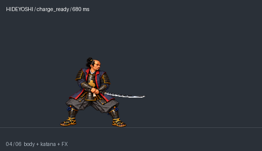

[遊戲速度動畫](actions/charge_ready/charge_ready.gif)

版本：twohand_head95；狀態：candidate

## charge_hold

8 格 / 880 ms

低馬步保持，雙手握點與腳點固定；腰部集氣提示輕微明暗循環，金扇始終收納。

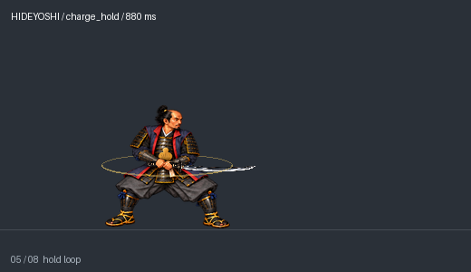

[遊戲速度動畫](actions/charge_hold/charge_hold.gif)

版本：twohand_head95；狀態：candidate

## charge_release

17 格 / 1240 ms

末段40ms蓄縮後100ms尖長銀刃爆射，獨立灰色示意敵人向外仰翻擊飛；原人物刀及兩次傷害事件不變。

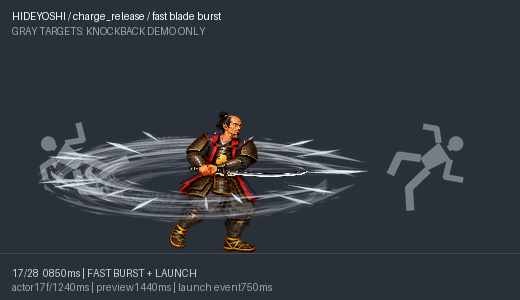

[遊戲速度動畫](actions/charge_release_fastburst_v8/charge_release_fastburst_v8.gif)

版本：approved_actor_silver_fastburst_enemy_demo_v8；狀態：candidate

預覽：28格 / 1440ms；人物動作仍17格 / 1240ms，額外時間僅顯示獨立FX尾段。

## air_light

11 格 / 620 ms

原地起跳與落地：腰帶／骨盆中心X固定，頭胸校準固有尺度；11格620ms。

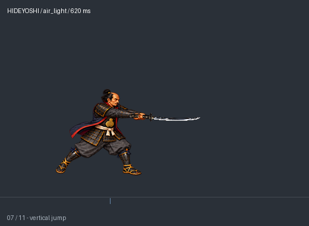

[遊戲速度動畫](actions/air_light/air_light_inplace_scale_v2.gif)

版本：inplace_scale_v2；狀態：candidate

## air_heavy

11 格 / 700 ms

前進一步空中落斬：骨盆沿連續前進弧線移動36px，落地後不退回；頭胸校準固有尺度。

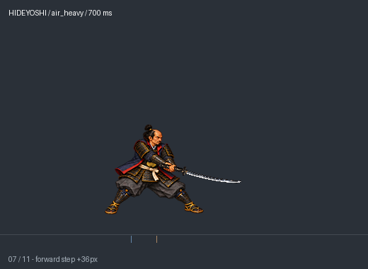

[遊戲速度動畫](actions/air_heavy/air_heavy_forwardstep_scale_v2.gif)

版本：forwardstep_scale_v2；狀態：candidate

## grab_start

5 格 / 520 ms

雙手抓住並拉近對手。

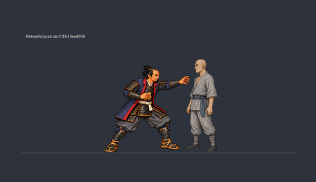

[遊戲速度動畫](grabs/normalized/grab_start/hideyoshi_grab_start_head95_game150_nobottle.gif)

版本：head95_game150_nobottle；狀態：candidate

## grab_hold

1 格 / 600 ms

維持抓點等待膝擊或投摔。

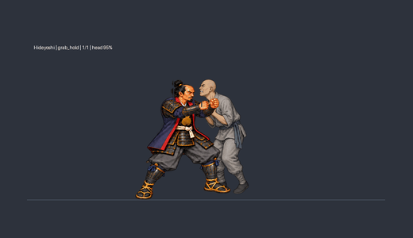

[遊戲速度動畫](grabs/normalized/grab_hold/hideyoshi_grab_hold_head95_game150_nobottle.gif)

版本：head95_game150_nobottle；狀態：candidate

## grab_hit_1

5 格 / 490 ms

拉住對手膝擊後回到保持；兩次接觸事件獨立。

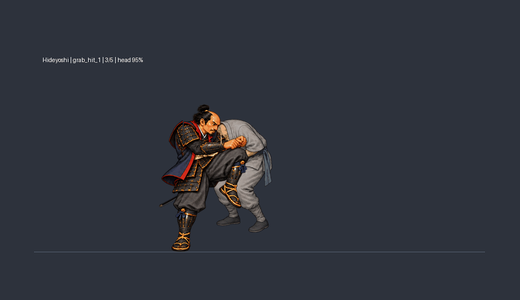

[遊戲速度動畫](grabs/normalized/grab_hit_1/hideyoshi_grab_hit_1_head95_game150.gif)

版本：twohand_head95_game150；狀態：candidate

## grab_hit_2

5 格 / 480 ms

拉住對手膝擊後回到保持；兩次接觸事件獨立。

[遊戲速度動畫](grabs/normalized/grab_hit_2/hideyoshi_grab_hit_2_head95_game150.gif)

版本：twohand_head95_game150；狀態：candidate

## throw_forward

8 格 / 820 ms

轉髖承肩向前釋放，對手獨立飛出落地。

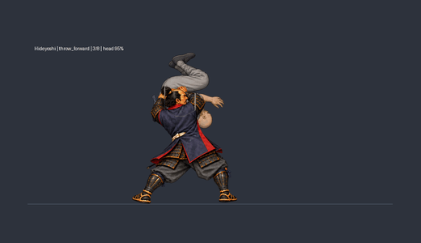

[遊戲速度動畫](grabs/normalized/throw_forward/hideyoshi_throw_forward_head95_game150_nobottle.gif)

版本：head95_game150_nobottle；狀態：candidate

## throw_reverse

8 格 / 840 ms

背面轉身承肩，向後方釋放對手。

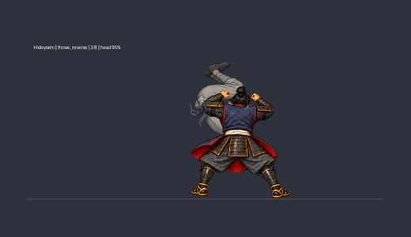

[遊戲速度動畫](grabs/normalized/throw_reverse/hideyoshi_throw_reverse_head95_game150_nobottle.gif)

版本：head95_game150_nobottle；狀態：candidate

## dash_heavy

8 格 / 580 ms

奔跑末步壓低重心，雙手快速前橫掃，再以前腳制動回站；一般敵人接觸擊飛。

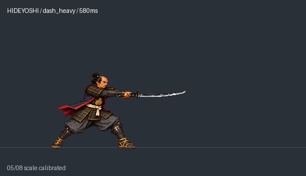

[遊戲速度動畫](actions/dash_heavy/dash_heavy.gif)

版本：twohand_head95_scale_calibrated；狀態：candidate