# 家康新版16招候選素材
2026-10-15。全索引統一152px站立等效尺規、一般560×400畫布、根點初始x=205；一閃三段640×400、起始腳點x=120；地面y=365。此包未進遊戲驗收。

## light_1
第一段：前踏斜橫斬，接觸推人後回正。
8播放格，720ms。
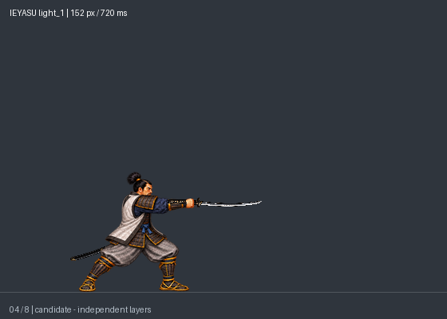
[正常動畫](preview_152px/light_1/normal.gif) · [慢速](preview_152px/light_1/slow.gif)

## light_2
第二段：肩後蓄勢反掃，保留前踏位移。
8播放格，760ms。
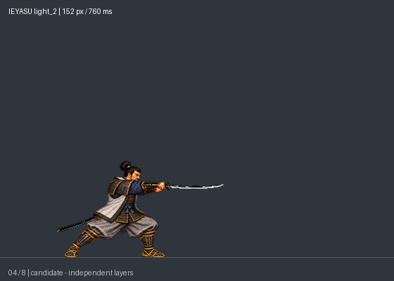
[正常動畫](preview_152px/light_2/normal.gif) · [慢速](preview_152px/light_2/slow.gif)

## light_3
第三段：沉肩轉髖大掃，命中擊飛。
10播放格，1000ms。
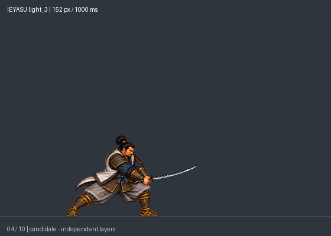
[正常動畫](preview_152px/light_3/normal.gif) · [慢速](preview_152px/light_3/slow.gif)

## heavy
普通重手：收刀、分段拔刀後水平前突；刀鞘留腰側。
10播放格，1140ms。
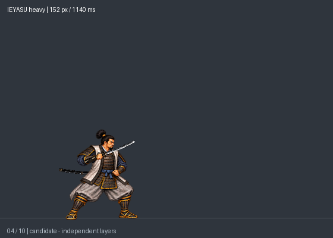
[正常動畫](preview_152px/heavy/normal.gif) · [慢速](preview_152px/heavy/slow.gif)

## charge_ready
一閃蓄勢：右手握柄、左手鞘口，刀鞘朝後，慢收刀並屈膝壓低。
6播放格，900ms。
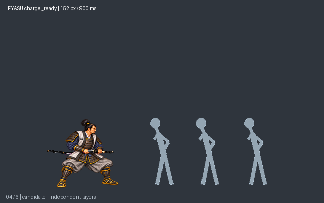
[正常動畫](preview_152px/charge_ready/normal.gif) · [慢速](preview_152px/charge_ready/slow.gif)

## charge_hold
一閃保持：完全入鞘、低姿待發；示範保持400ms，遊戲由放鍵決定。
1播放格，400ms。
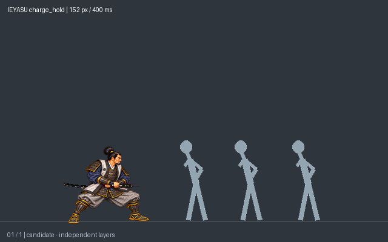
[正常動畫](preview_152px/charge_hold/normal.gif) · [慢速](preview_152px/charge_hold/slow.gif)

## charge_release
一閃施放：瞬間拔刀、三步前衝，關鍵踏步各100ms；末段水平前指停留；大型劍氣前向穿透、沿路敵人倒地，殘影／劍氣／量測敵人皆獨立層。
12播放格，800ms。
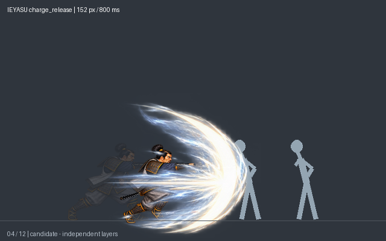
[正常動畫](preview_152px/charge_release/normal.gif) · [慢速](preview_152px/charge_release/slow.gif)

## air_light
空中輕手：起跳後主武近距離揮斬，下降落地。
8播放格，660ms。
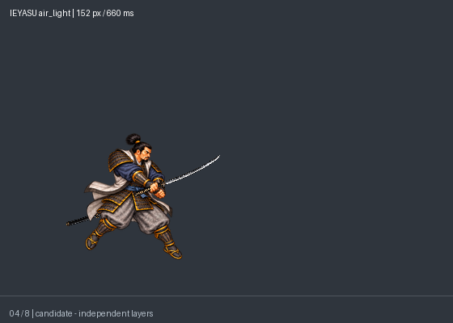
[正常動畫](preview_152px/air_light/normal.gif) · [慢速](preview_152px/air_light/slow.gif)

## air_heavy
空中重手：跳起向前一步52px、深下斬後低馬步落地，回收不滑回原點。
12播放格，850ms。
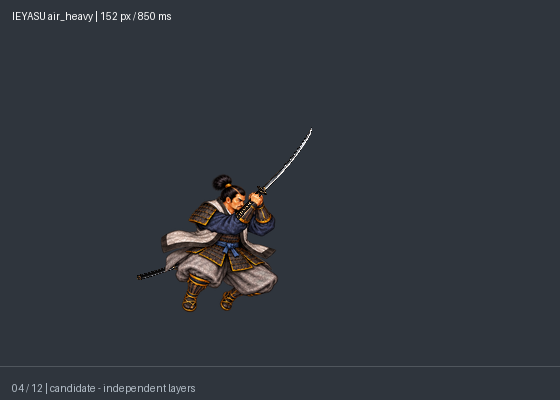
[正常動畫](preview_152px/air_heavy/normal.gif) · [慢速](preview_152px/air_heavy/slow.gif)

## grab_start
抓起：收刀安全收納、伸手閉握、拉近。
6播放格，600ms。
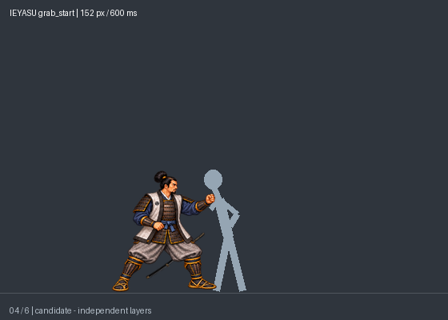
[正常動畫](preview_152px/grab_start/normal.gif) · [慢速](preview_152px/grab_start/slow.gif)

## grab_hold
抓握保持：固定衣領／上臂接點。
6播放格，600ms。
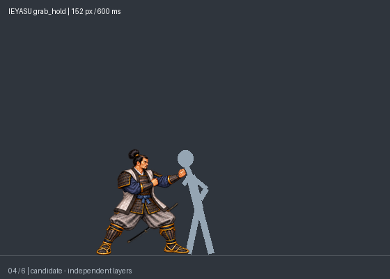
[正常動畫](preview_152px/grab_hold/normal.gif) · [慢速](preview_152px/grab_hold/slow.gif)

## grab_hit_1
第一頭槌：採用已選第二下的同套姿勢與600ms節奏；獨立第一下輸入與命中。
6播放格，600ms。
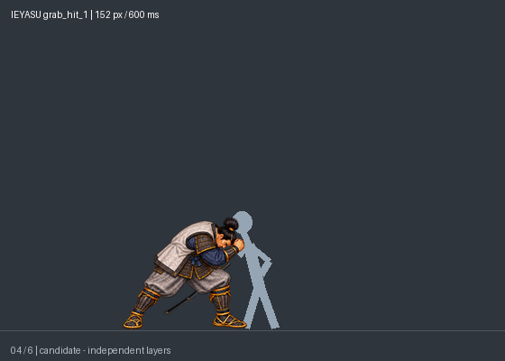
[正常動畫](preview_152px/grab_hit_1/normal.gif) · [慢速](preview_152px/grab_hit_1/slow.gif)

## grab_hit_2
第二頭槌：與第一下共用已選姿勢，600ms；獨立第二下輸入與命中，不自動兩連擊。
6播放格，600ms。

[正常動畫](preview_152px/grab_hit_2/normal.gif) · [慢速](preview_152px/grab_hit_2/slow.gif)

## throw_forward
前摔：轉髖前拋，轉髖後鬆手，被投者獨立飛出。
13播放格，1000ms。
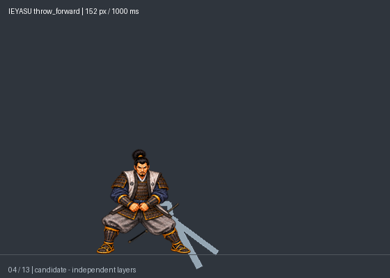
[正常動畫](preview_152px/throw_forward/normal.gif) · [慢速](preview_152px/throw_forward/slow.gif)

## throw_reverse
反摔：轉背上肩、反向過肩釋放，最後左向站穩。
12播放格，1100ms。
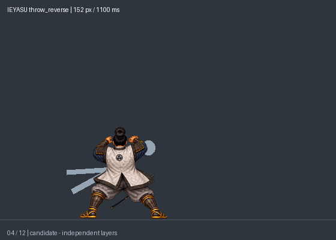
[正常動畫](preview_152px/throw_reverse/normal.gif) · [慢速](preview_152px/throw_reverse/slow.gif)

## dash_heavy
跑步重手：末步前掃、制動回站。
10播放格，800ms。
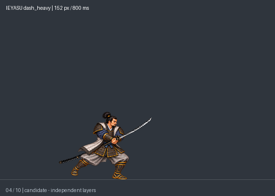
[正常動畫](preview_152px/dash_heavy/normal.gif) · [慢速](preview_152px/dash_heavy/slow.gif)
