# 四人 36 組基本動作：最終圖文交接

本多、秀吉、家康、顯如各 9 組，共 **36 組／212 格**，均依使用者「動作都OK了，把後續都處理好就上GIT」採 accepted 狀態。家康跑步鎖定 **run_v5**；原始來源、metadata、QA 與歷史說明完整保留。

入口：[總 manifest](four-heroes/manifest.json) · [原始 CODEX_HANDOFF](four-heroes/CODEX_HANDOFF.md) · [驗證結果](FOUR_HEROES_VALIDATION.json) · [來源與傳輸雜湊](FOUR_HEROES_PROVENANCE.json)。

## 播放與分層約定

`four-heroes/` 對應原包 `final_git_bundle` 根目錄；來源內的相對路徑及原始位元組均保留。

影格數依動作不同，必須使用逐格 duration 與事件，不能固定幀數或等時播放。body、weapon、hand_occlusion 依每格 back-to-front 順序合成；一般基本動作沒有 VFX。家康的 body 已包含刀鞘，不應再畫第二次。GIF 與證明圖只供檢閱，不能據此決定遊戲循環狀態。

保留來源高解析 PNG 與站立解剖尺規，不能按每格外框縮放人物；不要把小遊戲影格反覆放大生成。根點、腳點、握點、武器角度及索引依 contracts 讀取。未知的解剖左右腳保留 null，不以畫面左右排序猜測。預覽位移與世界位移分開，已烘焙的 pose offset 不能再加一次。

## 尚未完成的遊戲工作

- 引擎圖集匯入、貼圖／透明設定、根點與左右朝向轉換、影格時間換算。
- 碰撞、hitbox／hurtbox、取消與優先權、無敵及移動權限。
- 事件 callback、循環邊界去重、死亡停格、起身與拾武器／顯隱接線。
- 控制器、步行／跑步速度、跳躍／擊退物理、重力與接地。
- 遊戲比例下的實機播放、方向切換、低幀率、碰撞邊界、效能與音訊驗收。

本次僅驗證素材輸出與交付。**未修改 runtime，未宣稱完成引擎匯入、碰撞、事件、物理或效能測試。**

## 本多忠勝

站立尺規 163 px；9 組／53 格。[角色整合入口](four-heroes/tadakatsu/integration_manifest.json)。

| 動作 | 代表圖 | 動作說明 | 格數／總時長 | 播放設定與資料 |
|---|---|---|---|---|
| 步行 `walk` | 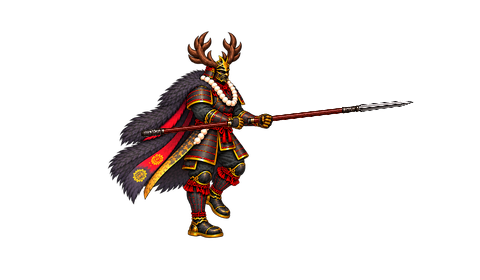 | 交替支撐與跨步姿勢；循環播放，實際移動速度由引擎控制。代表來源第 3 格。 | 8 格／1120 ms | 循環；[逐格 contract](four-heroes/contracts/tadakatsu/walk.json)、[原 metadata](four-heroes/tadakatsu/walk/metadata.json) |
| 跑步 `run` | 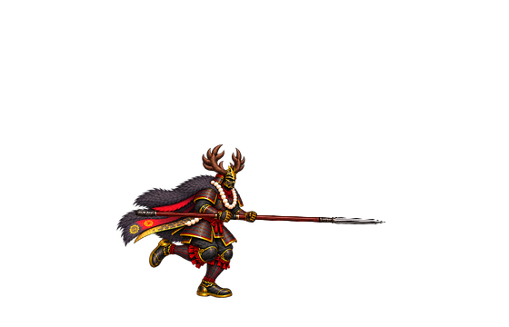 | 快速步態的支撐與騰空交替；預覽位移與世界移動分開使用。代表來源第 2 格。 | 8 格／600 ms | 循環；[逐格 contract](four-heroes/contracts/tadakatsu/run.json)、[原 metadata](four-heroes/tadakatsu/run/metadata.json) |
| 跳躍 `jump` | 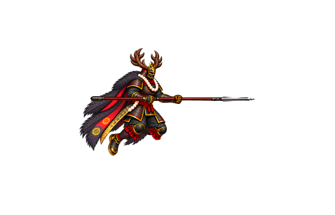 | 依逐格姿勢與起跳、頂點、落地標記銜接；重力及跳躍軌跡待引擎設定。代表來源第 4 格。 | 8 格／900 ms | 單次；[逐格 contract](four-heroes/contracts/tadakatsu/jump.json)、[原 metadata](four-heroes/tadakatsu/jump/metadata.json) |
| 受傷 `hurt` | 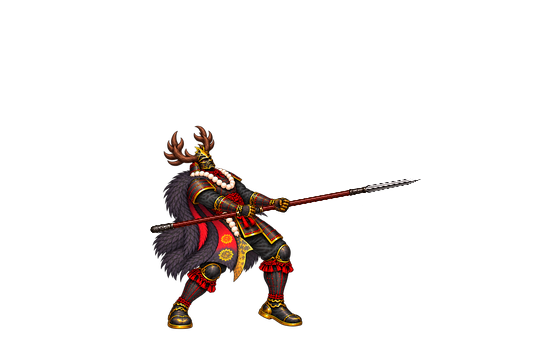 | 站立中受擊後仰與回穩；受擊中斷、無敵及轉換窗口待引擎設定。代表來源第 3 格。 | 6 格／620 ms | 單次；[逐格 contract](four-heroes/contracts/tadakatsu/hurt.json)、[原 metadata](four-heroes/tadakatsu/hurt/metadata.json) |
| 暈眩 `stunned` | 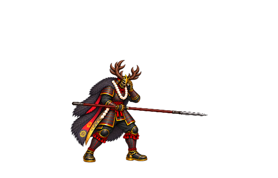 | 無特效的循環暈眩姿勢；解除條件與持續時間由遊戲狀態控制。代表來源第 2 格。 | 4 格／800 ms | 循環；[逐格 contract](four-heroes/contracts/tadakatsu/stunned.json)、[原 metadata](four-heroes/tadakatsu/stunned/metadata.json) |
| 被擊飛 `launched` | 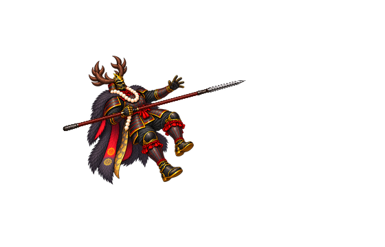 | 後仰離地的受擊姿勢；實際擊退、重力及落地碰撞尚未測試。代表來源第 3 格。 | 5 格／490 ms | 單次；[逐格 contract](four-heroes/contracts/tadakatsu/launched.json)、[原 metadata](four-heroes/tadakatsu/launched/metadata.json) |
| 倒地 `down` | 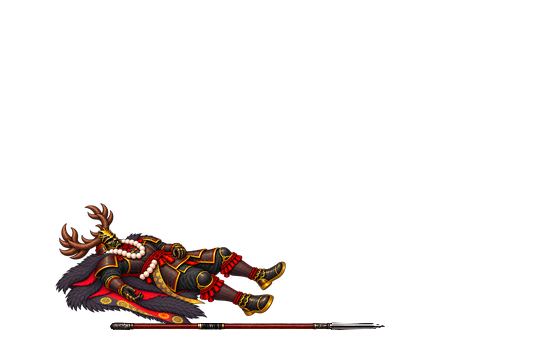 | 倒下並保留末格，可作死亡停格；死亡與起身切換待引擎接線。代表來源第 4 格。 | 4 格／870 ms | 單次；末格保持；[逐格 contract](four-heroes/contracts/tadakatsu/down.json)、[原 metadata](four-heroes/tadakatsu/down/metadata.json) |
| 起身 `recovering` | 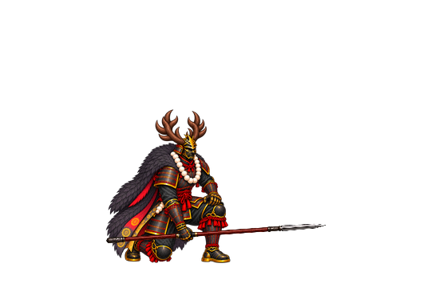 | 從倒地起身、收回武器並銜接已登錄待機；拾取與武器顯隱尚未接入遊戲。代表來源第 4 格。 | 6 格／870 ms | 單次；[逐格 contract](four-heroes/contracts/tadakatsu/recovering.json)、[原 metadata](four-heroes/tadakatsu/recovering/metadata.json) |
| 勝利 `victory` | 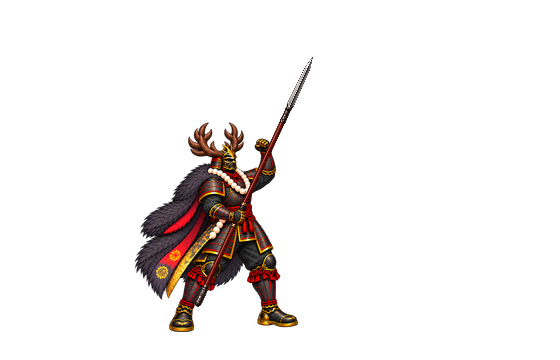 | 完成角色勝利手勢；依本列末格保持設定決定停格或後續轉換。代表來源第 3 格。 | 4 格／1140 ms | 單次；末格保持；[逐格 contract](four-heroes/contracts/tadakatsu/victory.json)、[原 metadata](four-heroes/tadakatsu/victory/metadata.json) |

## 豐臣秀吉

站立尺規 150 px；9 組／56 格。[角色整合入口](four-heroes/hideyoshi/integration_manifest.json)。

| 動作 | 代表圖 | 動作說明 | 格數／總時長 | 播放設定與資料 |
|---|---|---|---|---|
| 步行 `walk` | 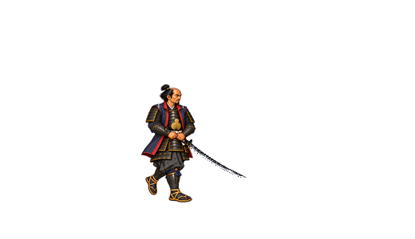 | 交替支撐與跨步姿勢；循環播放，實際移動速度由引擎控制。代表來源第 3 格。 | 8 格／960 ms | 循環；[逐格 contract](four-heroes/contracts/hideyoshi/walk.json)、[原 metadata](four-heroes/hideyoshi/walk/metadata.json) |
| 跑步 `run` | 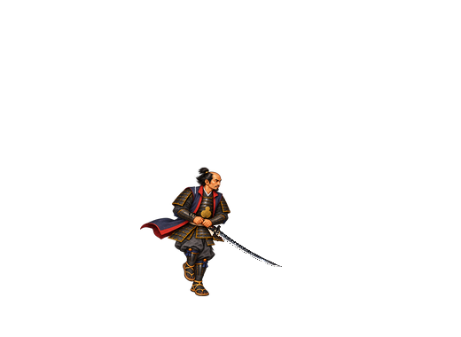 | 快速步態的支撐與騰空交替；預覽位移與世界移動分開使用。代表來源第 2 格。 | 6 格／480 ms | 循環；[逐格 contract](four-heroes/contracts/hideyoshi/run.json)、[原 metadata](four-heroes/hideyoshi/run/metadata.json) |
| 跳躍 `jump` | 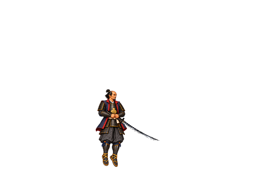 | 依逐格姿勢與起跳、頂點、落地標記銜接；重力及跳躍軌跡待引擎設定。代表來源第 4 格。 | 10 格／900 ms | 單次；[逐格 contract](four-heroes/contracts/hideyoshi/jump.json)、[原 metadata](four-heroes/hideyoshi/jump/metadata.json) |
| 受傷 `hurt` | 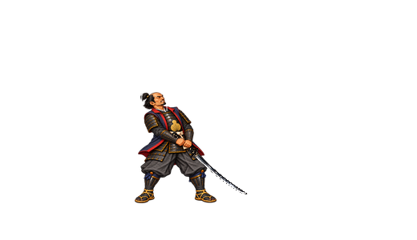 | 站立中受擊後仰與回穩；受擊中斷、無敵及轉換窗口待引擎設定。代表來源第 3 格。 | 6 格／480 ms | 單次；[逐格 contract](four-heroes/contracts/hideyoshi/hurt.json)、[原 metadata](four-heroes/hideyoshi/hurt/metadata.json) |
| 暈眩 `stunned` | 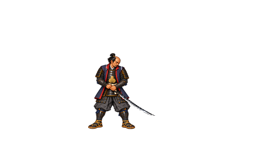 | 無特效的循環暈眩姿勢；解除條件與持續時間由遊戲狀態控制。代表來源第 2 格。 | 4 格／800 ms | 循環；[逐格 contract](four-heroes/contracts/hideyoshi/stunned.json)、[原 metadata](four-heroes/hideyoshi/stunned/metadata.json) |
| 被擊飛 `launched` | 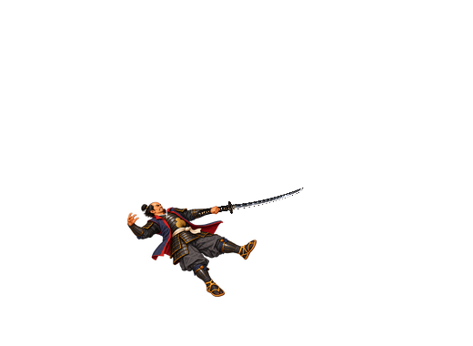 | 後仰離地的受擊姿勢；實際擊退、重力及落地碰撞尚未測試。代表來源第 3 格。 | 6 格／500 ms | 單次；[逐格 contract](four-heroes/contracts/hideyoshi/launched.json)、[原 metadata](four-heroes/hideyoshi/launched/metadata.json) |
| 倒地 `down` | 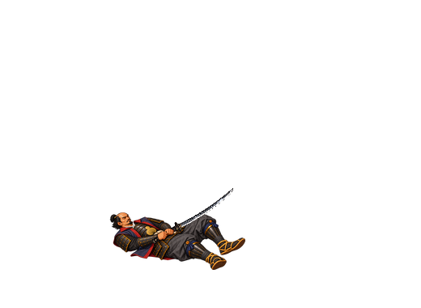 | 倒下並保留末格，可作死亡停格；死亡與起身切換待引擎接線。代表來源第 4 格。 | 4 格／620 ms | 單次；末格保持；[逐格 contract](four-heroes/contracts/hideyoshi/down.json)、[原 metadata](four-heroes/hideyoshi/down/metadata.json) |
| 起身 `recovering` | 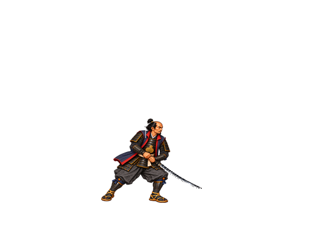 | 從倒地起身、收回武器並銜接已登錄待機；拾取與武器顯隱尚未接入遊戲。代表來源第 4 格。 | 6 格／900 ms | 單次；[逐格 contract](four-heroes/contracts/hideyoshi/recovering.json)、[原 metadata](four-heroes/hideyoshi/recovering/metadata.json) |
| 勝利 `victory` | 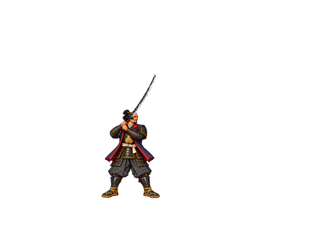 | 完成角色勝利手勢；依本列末格保持設定決定停格或後續轉換。代表來源第 3 格。 | 6 格／1300 ms | 單次；[逐格 contract](four-heroes/contracts/hideyoshi/victory.json)、[原 metadata](four-heroes/hideyoshi/victory/metadata.json) |

## 德川家康06

站立尺規 152 px；9 組／50 格。[角色整合入口](four-heroes/ieyasu/integration_manifest.json)。

| 動作 | 代表圖 | 動作說明 | 格數／總時長 | 播放設定與資料 |
|---|---|---|---|---|
| 步行 `walk` | 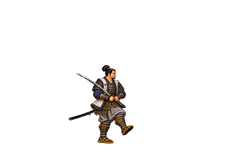 | 交替支撐與跨步姿勢；循環播放，實際移動速度由引擎控制。代表來源第 3 格。 | 8 格／1080 ms | 循環；[逐格 contract](four-heroes/contracts/ieyasu/walk.json)、[原 metadata](four-heroes/ieyasu/walk/metadata.json) |
| 跑步 `run` | 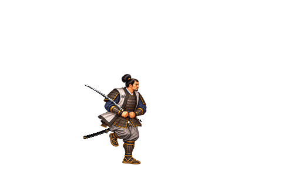 | 鎖定 run_v5，保留已驗收腿部像素與腳步軌跡，上半身採最新修訂。快速步態的支撐與騰空交替；預覽位移與世界移動分開使用。代表來源第 2 格。 | 6 格／500 ms | 循環；[逐格 contract](four-heroes/contracts/ieyasu/run.json)、[原 metadata](four-heroes/ieyasu/run_v5/metadata.json) |
| 跳躍 `jump` | 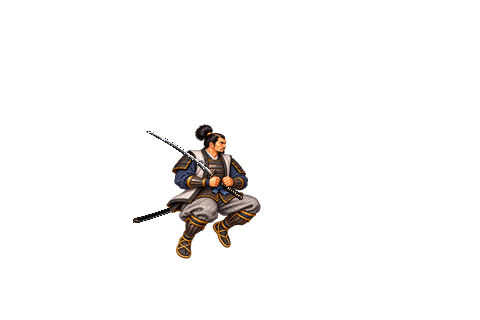 | 依逐格姿勢與起跳、頂點、落地標記銜接；重力及跳躍軌跡待引擎設定。代表來源第 4 格。 | 8 格／980 ms | 單次；[逐格 contract](four-heroes/contracts/ieyasu/jump.json)、[原 metadata](four-heroes/ieyasu/jump/metadata.json) |
| 受傷 `hurt` | 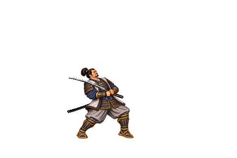 | 站立中受擊後仰與回穩；受擊中斷、無敵及轉換窗口待引擎設定。代表來源第 3 格。 | 6 格／710 ms | 單次；[逐格 contract](four-heroes/contracts/ieyasu/hurt.json)、[原 metadata](four-heroes/ieyasu/hurt/metadata.json) |
| 暈眩 `stunned` | 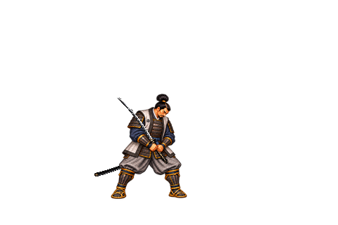 | 無特效的循環暈眩姿勢；解除條件與持續時間由遊戲狀態控制。代表來源第 2 格。 | 4 格／1080 ms | 循環；[逐格 contract](four-heroes/contracts/ieyasu/stunned.json)、[原 metadata](four-heroes/ieyasu/stunned/metadata.json) |
| 被擊飛 `launched` | 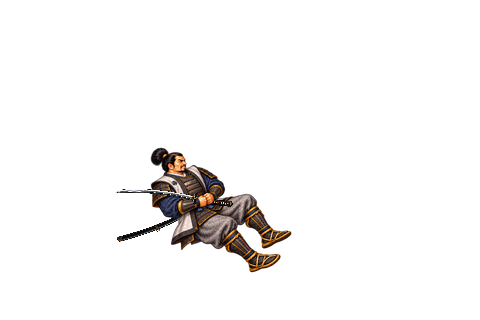 | 後仰離地的受擊姿勢；實際擊退、重力及落地碰撞尚未測試。代表來源第 3 格。 | 5 格／540 ms | 單次；末格保持；[逐格 contract](four-heroes/contracts/ieyasu/launched.json)、[原 metadata](four-heroes/ieyasu/launched/metadata.json) |
| 倒地 `down` | 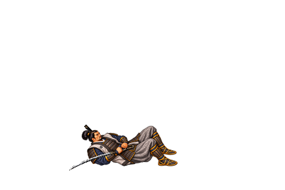 | 倒下並保留末格，可作死亡停格；死亡與起身切換待引擎接線。代表來源第 2 格。 | 2 格／1030 ms | 單次；末格保持；[逐格 contract](four-heroes/contracts/ieyasu/down.json)、[原 metadata](four-heroes/ieyasu/down/metadata.json) |
| 起身 `recovering` | 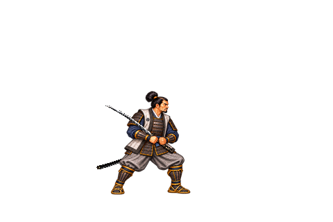 | 從倒地起身、收回武器並銜接已登錄待機；拾取與武器顯隱尚未接入遊戲。代表來源第 4 格。 | 5 格／870 ms | 單次；[逐格 contract](four-heroes/contracts/ieyasu/recovering.json)、[原 metadata](four-heroes/ieyasu/recovering/metadata.json) |
| 勝利 `victory` | 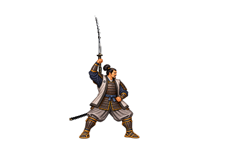 | 完成角色勝利手勢；依本列末格保持設定決定停格或後續轉換。代表來源第 3 格。 | 6 格／1300 ms | 單次；[逐格 contract](four-heroes/contracts/ieyasu/victory.json)、[原 metadata](four-heroes/ieyasu/victory_v2/metadata.json) |

## 本願寺顯如03

站立尺規 163 px；9 組／53 格。[角色整合入口](four-heroes/kennyo/integration_manifest.json)。

| 動作 | 代表圖 | 動作說明 | 格數／總時長 | 播放設定與資料 |
|---|---|---|---|---|
| 步行 `walk` | 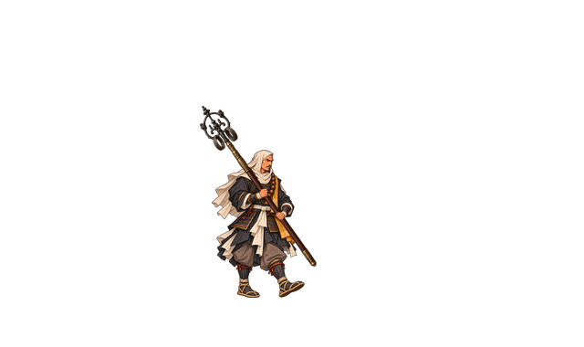 | 交替支撐與跨步姿勢；循環播放，實際移動速度由引擎控制。代表來源第 3 格。 | 8 格／880 ms | 循環；[逐格 contract](four-heroes/contracts/kennyo/walk.json)、[原 metadata](four-heroes/kennyo/walk_v11/metadata.json) |
| 跑步 `run` | 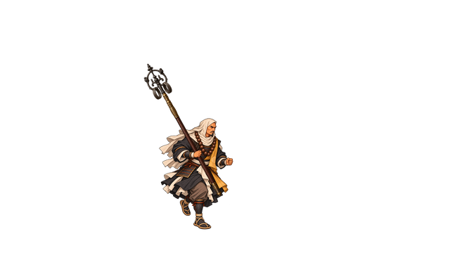 | 快速步態的支撐與騰空交替；預覽位移與世界移動分開使用。代表來源第 2 格。 | 8 格／600 ms | 循環；[逐格 contract](four-heroes/contracts/kennyo/run.json)、[原 metadata](four-heroes/kennyo/run/metadata.json) |
| 跳躍 `jump` | 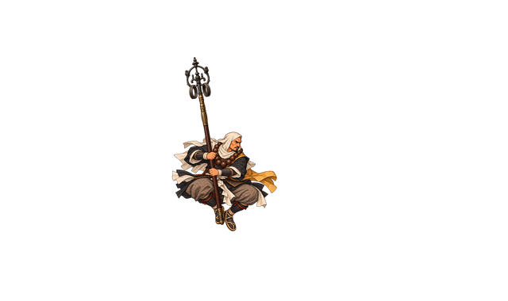 | 依逐格姿勢與起跳、頂點、落地標記銜接；重力及跳躍軌跡待引擎設定。代表來源第 4 格。 | 7 格／830 ms | 單次；[逐格 contract](four-heroes/contracts/kennyo/jump.json)、[原 metadata](four-heroes/kennyo/jump/metadata.json) |
| 受傷 `hurt` | 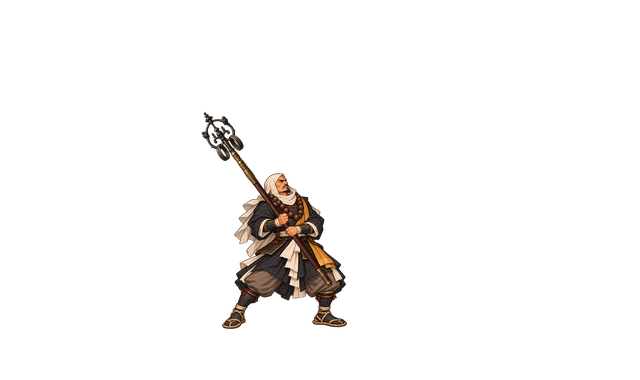 | 站立中受擊後仰與回穩；受擊中斷、無敵及轉換窗口待引擎設定。代表來源第 3 格。 | 5 格／480 ms | 單次；[逐格 contract](four-heroes/contracts/kennyo/hurt.json)、[原 metadata](four-heroes/kennyo/hurt/metadata.json) |
| 暈眩 `stunned` | 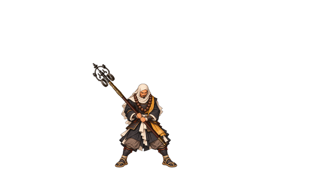 | 無特效的循環暈眩姿勢；解除條件與持續時間由遊戲狀態控制。代表來源第 2 格。 | 4 格／800 ms | 循環；[逐格 contract](four-heroes/contracts/kennyo/stunned.json)、[原 metadata](four-heroes/kennyo/stunned/metadata.json) |
| 被擊飛 `launched` | 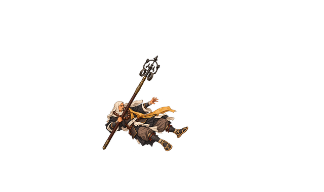 | 後仰離地的受擊姿勢；實際擊退、重力及落地碰撞尚未測試。代表來源第 3 格。 | 5 格／420 ms | 單次；[逐格 contract](four-heroes/contracts/kennyo/launched.json)、[原 metadata](four-heroes/kennyo/launched/metadata.json) |
| 倒地 `down` | 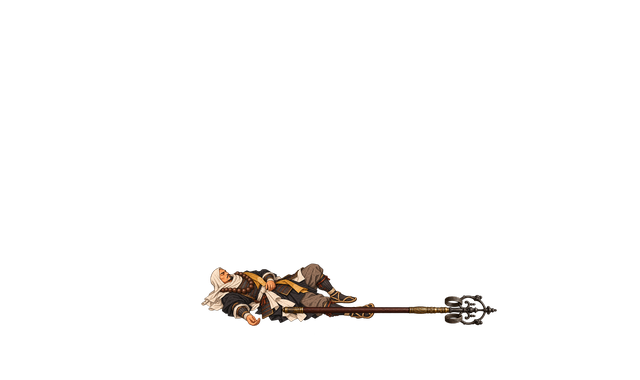 | 倒下並保留末格，可作死亡停格；死亡與起身切換待引擎接線。代表來源第 4 格。 | 4 格／870 ms | 單次；末格保持；[逐格 contract](four-heroes/contracts/kennyo/down.json)、[原 metadata](four-heroes/kennyo/down/metadata.json) |
| 起身 `recovering` | 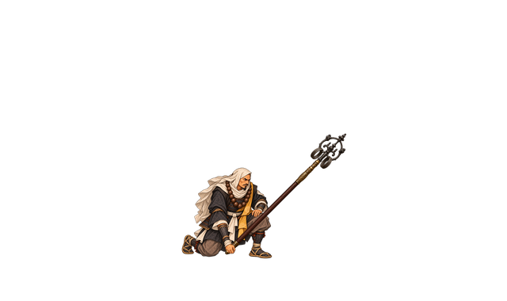 | 從倒地起身、收回武器並銜接已登錄待機；拾取與武器顯隱尚未接入遊戲。代表來源第 4 格。 | 7 格／950 ms | 單次；[逐格 contract](four-heroes/contracts/kennyo/recovering.json)、[原 metadata](four-heroes/kennyo/recovering/metadata.json) |
| 勝利 `victory` | 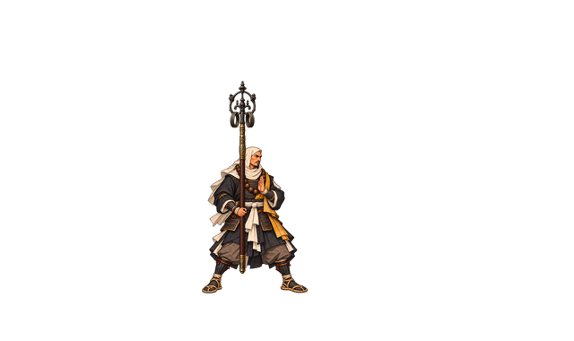 | 完成角色勝利手勢；依本列末格保持設定決定停格或後續轉換。代表來源第 3 格。 | 5 格／1540 ms | 單次；[逐格 contract](four-heroes/contracts/kennyo/victory.json)、[原 metadata](four-heroes/kennyo/victory/metadata.json) |

## 待機、肖像與重跑驗證

四份正式登錄戰鬥待機與四份由核准圖源裁出的肖像均在各角色整合入口，沿用原始來源，沒有另畫身份或改動已驗收動作。

在此目錄執行（Python 3＋Pillow）：

```powershell
python -X utf8 four-heroes/tools/verify_final_bundle.py
```

封裝驗證已通過 36 組 accepted、212 格三層精確重組、透明安全邊界、逐格時間與根點／握點／腳點、角色與總 SHA 清單、run_v5 選版及單檔限制。四張代表圖表已人工開啟抽查；這不代表已在遊戲播放或逐格人工驗收。
