# 信長 16 招：最終高解析圖文交接

使用者已驗收全部 16 招；本批為 **232 格／10,520 ms**。選版以 [delivery-manifest](nobunaga/delivery-manifest.json) 為準。[原始 README](nobunaga/README.md) · [逐項接入契約](nobunaga/INTEGRATION-CONTRACT.md) · [換武器缺口清單](nobunaga/weapon-swap-gaps.json) · [本機驗證結果](NOBUNAGA_VALIDATION.json)。

## 鎖版與分層

反摔採 `throw_reverse_planted_v2`（16 格／800 ms）；抓起、抓住、兩次抓擊、正摔與反摔共六招均採持刀版；滿蓄施放採 `charge_release_hires_range150`，保留核准的 150% 範圍規格。這些是素材／玩法交接要求，未宣稱已在引擎套用或測試。

保留原生高解析透明 master，不能以 GIF、代表圖或小型 review PNG 放大替代。影格數與 duration 依各招 metadata，不能固定 FPS 或按外框縮放蹲姿。站立參考為原始手動量測 914 native px（約 ±5 px）；各格畫布、root、腳與握點依原資料保留。

目前圖層是核准外觀的可見像素分拆，與 master 同畫布、同座標，以 identity transform 合成 body → weapon → hand_occlusion；反摔欄位為 body → weapon-visible → hand-foreground。滿蓄另依 FX back → actor → FX front 合成。232 格可見 RGBA 與 alpha 精確相同；全透明區 RGB 可能不同，不宣稱所有招式 RGBA 位元全部相等。反摔完整 RGBA 相等已有來源驗證。

## Codex 必須接手的換武器缺口

- 尚未補齊被刀、手或軀幹遮住的身體／刀身底圖。232 格共有 165 個不重複 actor master，這是 underlap 檢查上界，不是全部需重畫的數量。
- `charge_release` 000–023、`grab_start` 000–007、`throw_forward` 011–018 只有獨立鋼刃；刀柄／護手仍部分融合在人物或手部層，不能宣稱可任意替換整刀。
- `grab_start` 003 與 `throw_forward` 015 的原核准臉部在刀旁有透明擦除缺口；新武器露出該區時，須另加局部 hidden-fill，保留核准 master 不變。
- 反摔 005 的刀被軀幹遮擋，015 刀尖超出畫布；沒有補畫原本不可見的部分。
- 選定替換武器後，按 [逐格缺口清單](nobunaga/weapon-swap-gaps.json) 檢查，再另做底圖／完整武器替代層；重組原核准外觀必須保持不變。暗色接觸邊界的像素歸屬也需按實際替換武器再查。

**現用刀可見分層重組通過，不代表完整換武器 rig、隱藏底圖或 runtime 已完成。**

## 逐招代表圖與動作說明

表內代表圖供定位姿勢；正常速度核准 GIF、逐格來源與 metadata 均附連結。GIF 重播不等於攻擊在遊戲中循環。

| 招式 | 代表圖 | 動作與選版說明 | 格數／總時長 | 預覽與資料 |
|---|---|---|---|---|
| 輕手第一段 `light_1` | 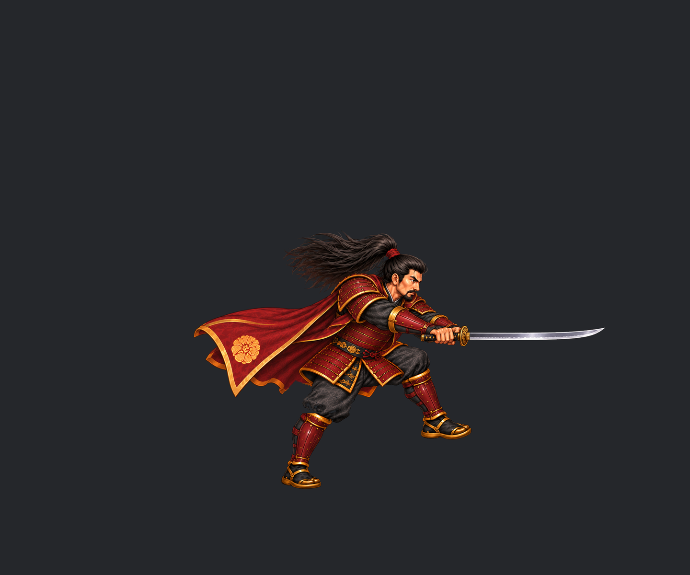 | 第一段前踏揮刀，接觸後回正；以獨立按鍵啟動，不自動播放完整三連段。 | 16 格／600 ms | [核准 GIF](nobunaga/light_1/preview-approved.gif)、[逐格登錄](nobunaga/light_1/delivery-frames.json)、[原生透明 master](nobunaga/light_1/frames-composite) |
| 輕手第二段 `light_2` | 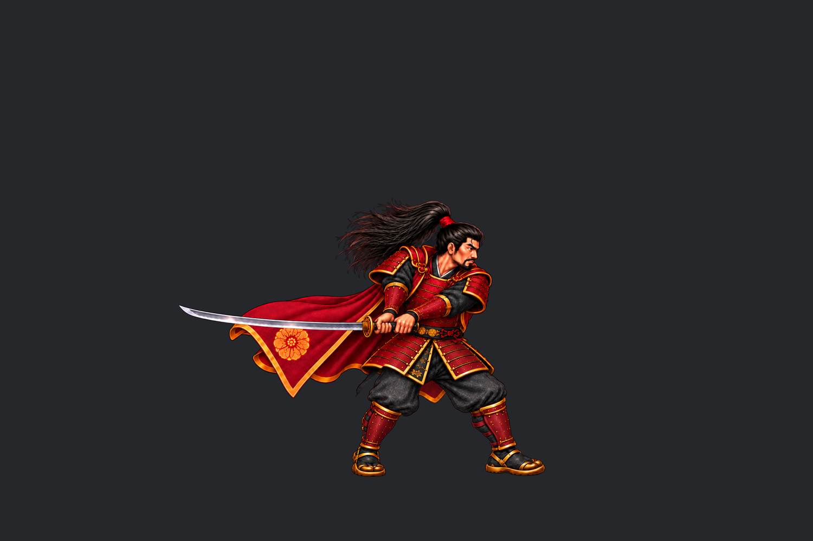 | 承接第一段後另按追加的前踏揮刀與回正；採 candidate-f 的已選來源。 | 15 格／600 ms | [核准 GIF](nobunaga/light_2/preview-approved.gif)、[逐格登錄](nobunaga/light_2/delivery-frames.json)、[原生透明 master](nobunaga/light_2/frames-composite) |
| 輕手第三段 `light_3` | 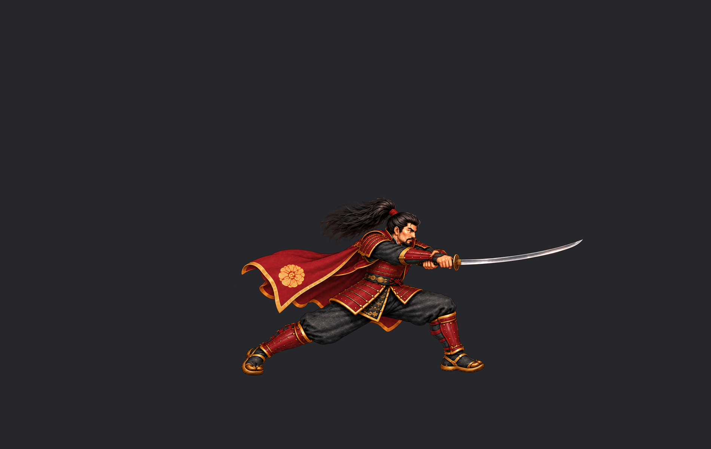 | 三段連擊收尾、發力與擊飛表現；僅採已選 15 格，不使用原資料夾其餘候選格。 | 15 格／720 ms | [核准 GIF](nobunaga/light_3/preview-approved.gif)、[逐格登錄](nobunaga/light_3/delivery-frames.json)、[原生透明 master](nobunaga/light_3/frames-composite) |
| 普通重手 `heavy` | 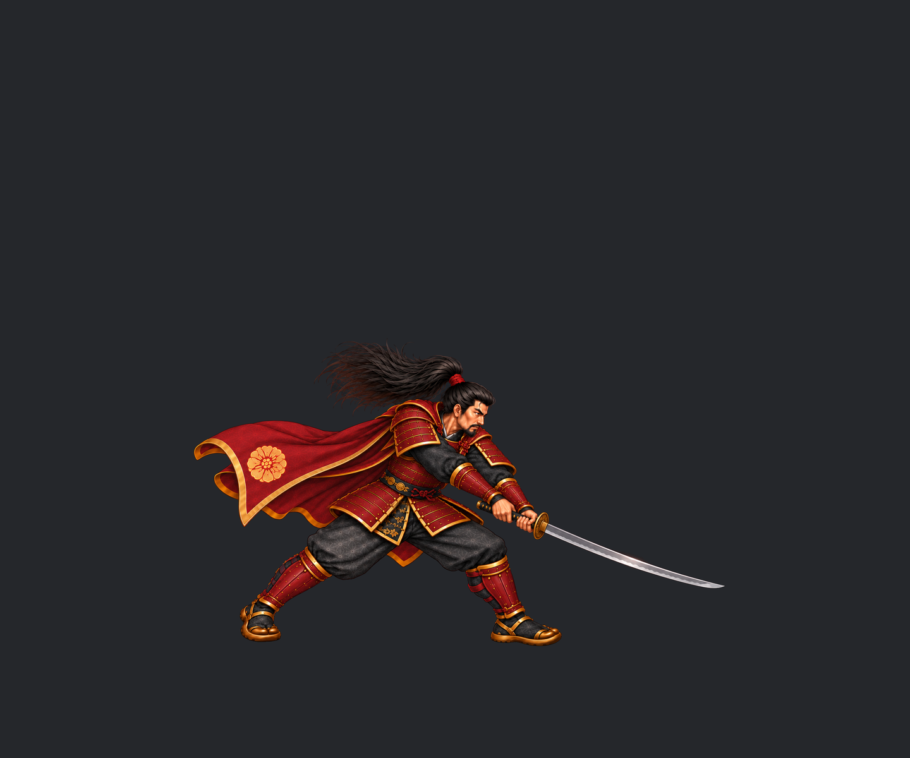 | 較長預備後下斬、發波與收招；實際命中、傷害與可中斷窗口待遊戲接入。 | 16 格／960 ms | [核准 GIF](nobunaga/heavy/preview-approved.gif)、[逐格登錄](nobunaga/heavy/delivery-frames.json)、[原生透明 master](nobunaga/heavy/frames-composite) |
| 蓄力起手 `charge_ready` | 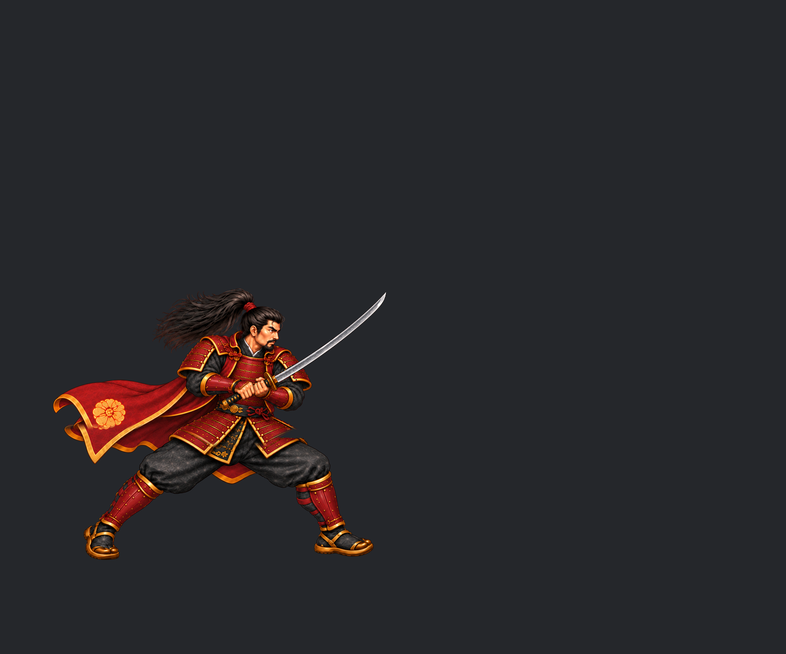 | 進入下蹲集氣姿勢；使用完整合成人物與武器，原生 donor 圖不能直接替代。 | 9 格／360 ms | [核准 GIF](nobunaga/charge_ready/preview-approved.gif)、[逐格登錄](nobunaga/charge_ready/delivery-frames.json)、[原生透明 master](nobunaga/charge_ready/frames-composite) |
| 滿蓄保持 `charge_hold` | 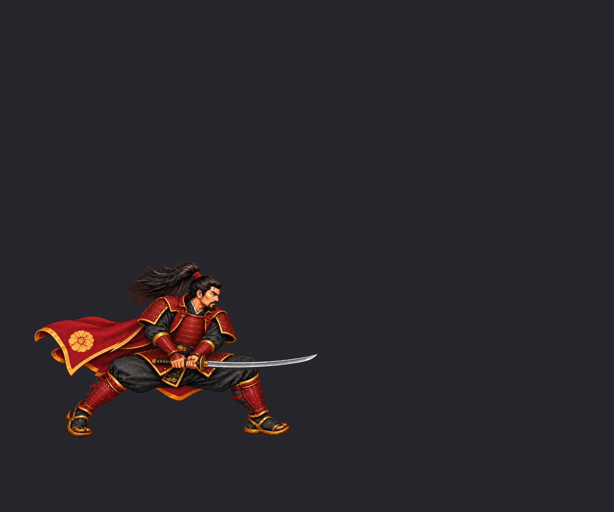 | 保持集氣姿勢的循環；核准首尾相同，放開施放的遊戲狀態尚未接線。 | 9 格／520 ms | [核准 GIF](nobunaga/charge_hold/preview-approved.gif)、[逐格登錄](nobunaga/charge_hold/delivery-frames.json)、[原生透明 master](nobunaga/charge_hold/frames-composite) |
| 滿蓄施放 `charge_release` | 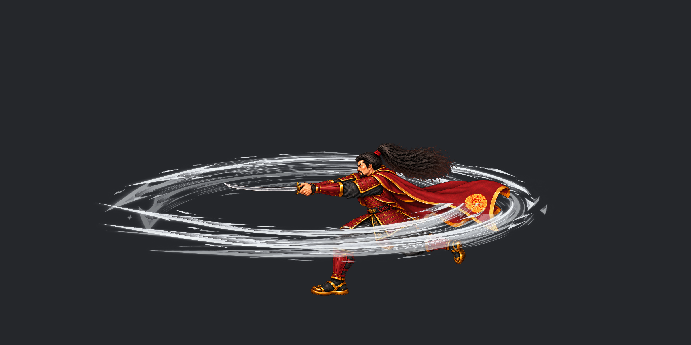 | 採 range150 核准版的旋斬、壓縮、外擴與殘留消散；範圍規格為 150%，不藉放大人物代替。FX 前後層獨立。 | 24 格／1400 ms | [核准 GIF](nobunaga/charge_release/preview-approved.gif)、[逐格登錄](nobunaga/charge_release/delivery-frames.json)、[原生透明 master](nobunaga/charge_release/frames-composite) |
| 空中輕手 `air_light` | 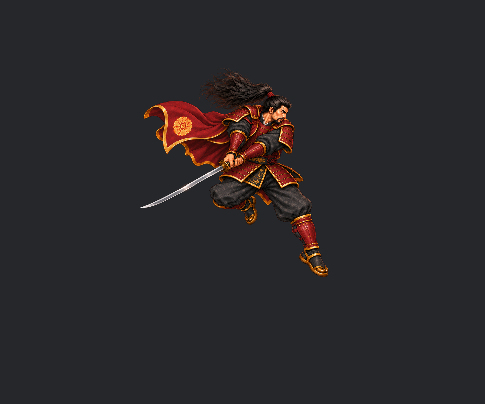 | 離地近身揮刀、隨動及落地回正；世界跳躍軌跡、判定與落地事件待引擎驗收。 | 16 格／640 ms | [核准 GIF](nobunaga/air_light/preview-approved.gif)、[逐格登錄](nobunaga/air_light/delivery-frames.json)、[原生透明 master](nobunaga/air_light/frames-composite) |
| 空中重手 `air_heavy` | 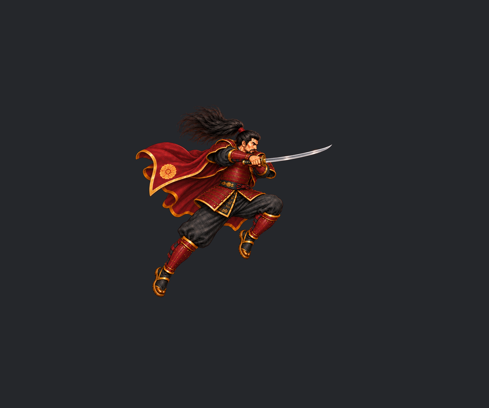 | 空中舉刀、下斬與重落地收招；藝術落地標記不直接當成碰撞或傷害觸發。 | 16 格／840 ms | [核准 GIF](nobunaga/air_heavy/preview-approved.gif)、[逐格登錄](nobunaga/air_heavy/delivery-frames.json)、[原生透明 master](nobunaga/air_heavy/frames-composite) |
| 抓取起手 `grab_start` | 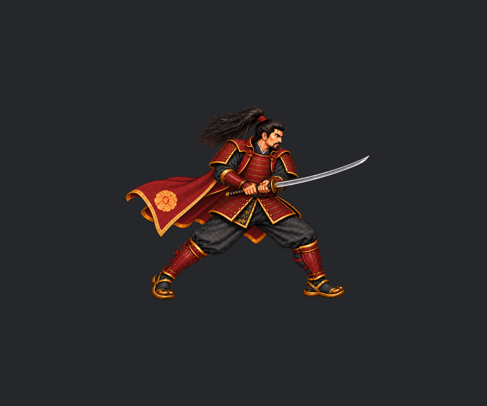 | 持刀伸手抓取並銜接抓住保持；前八格與最後四格依最終 source mapping 選取。 | 12 格／400 ms | [核准 GIF](nobunaga/grab_start/preview-approved.gif)、[逐格登錄](nobunaga/grab_start/delivery-frames.json)、[原生透明 master](nobunaga/grab_start/frames-composite) |
| 抓住保持 `grab_hold` | 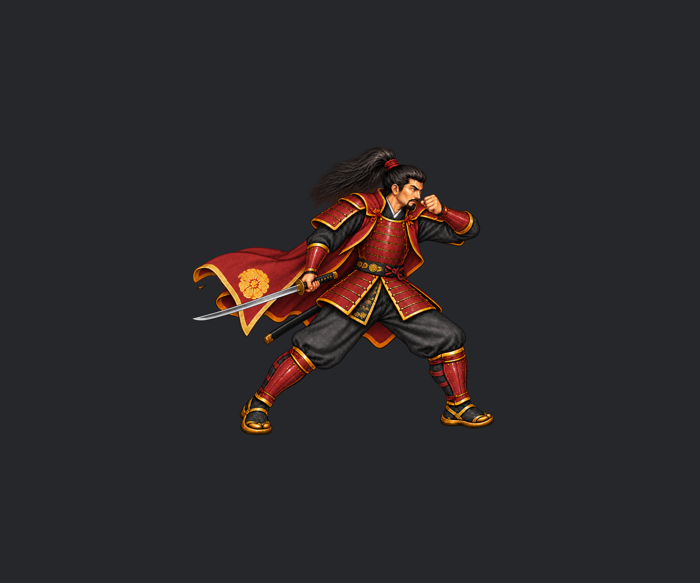 | 持刀穩定保持抓取姿勢；遊戲中的受害者附著、取消與放手時點仍待接入。 | 9 格／520 ms | [核准 GIF](nobunaga/grab_hold/preview-approved.gif)、[逐格登錄](nobunaga/grab_hold/delivery-frames.json)、[原生透明 master](nobunaga/grab_hold/frames-composite) |
| 抓中第一擊 `grab_hit_1` |  | 維持持刀與抓取的第一個獨立打擊及回穩；接觸標記不等同已接好的傷害事件。 | 13 格／440 ms | [核准 GIF](nobunaga/grab_hit_1/preview-approved.gif)、[逐格登錄](nobunaga/grab_hit_1/delivery-frames.json)、[原生透明 master](nobunaga/grab_hit_1/frames-composite) |
| 抓中第二擊 `grab_hit_2` | 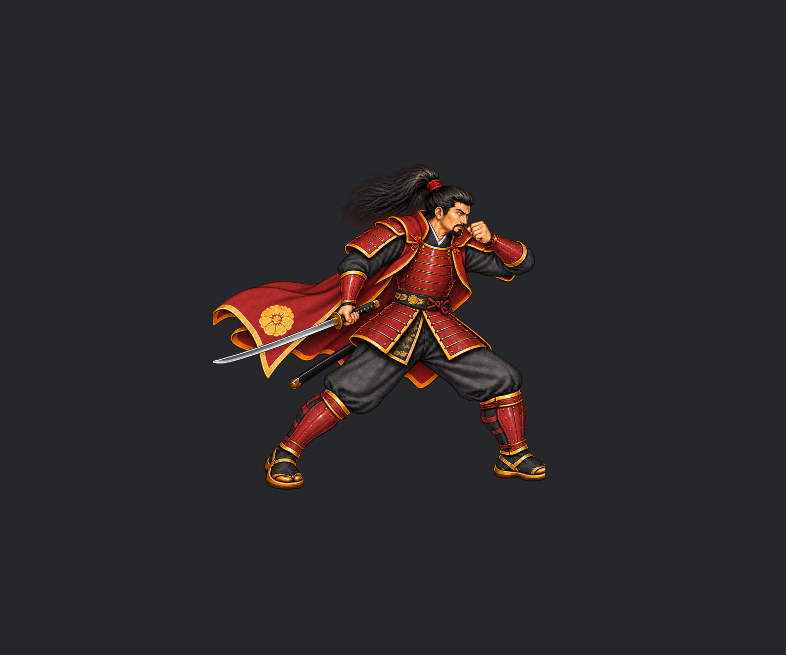 | 第二個獨立打擊與回穩，保持抓取接點；不以一次輸入自動播放後續投摔。 | 13 格／440 ms | [核准 GIF](nobunaga/grab_hit_2/preview-approved.gif)、[逐格登錄](nobunaga/grab_hit_2/delivery-frames.json)、[原生透明 master](nobunaga/grab_hit_2/frames-composite) |
| 正向摔 `throw_forward` | 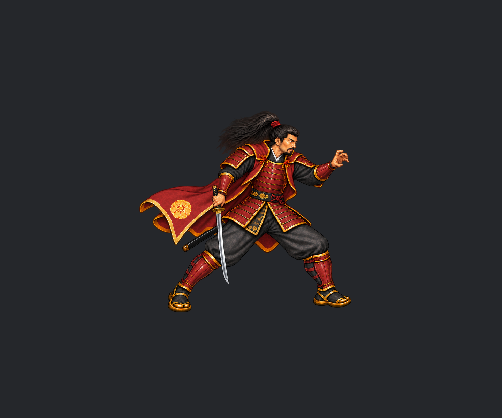 | 持刀正向投摔後回到持刀預備；009–018 沿用抓起恢復來源，不從小型 review 圖放大。 | 19 格／680 ms | [核准 GIF](nobunaga/throw_forward/preview-approved.gif)、[逐格登錄](nobunaga/throw_forward/delivery-frames.json)、[原生透明 master](nobunaga/throw_forward/frames-composite) |
| 反向過肩摔 `throw_reverse` | 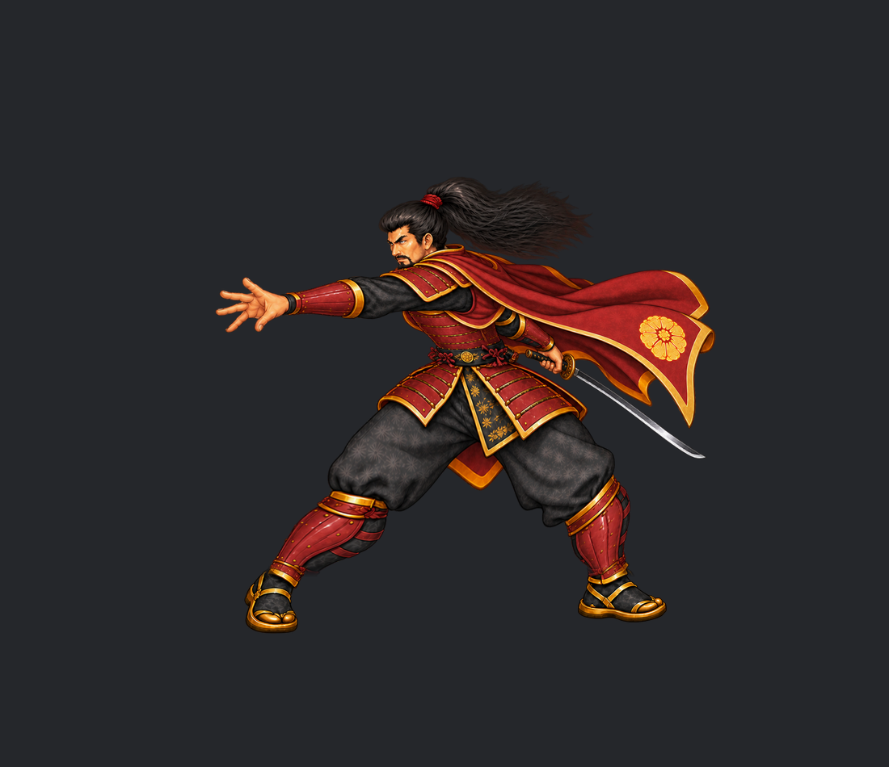 | 鎖定 planted_v2，16 格各 50 ms，共 800 ms；持刀反向投摔、明確鬆手、收招站穩，取代舊版 23 格。 | 16 格／800 ms | [核准 GIF](nobunaga/throw_reverse/preview-approved.gif)、[逐格登錄](nobunaga/throw_reverse/delivery-frames.json)、[原生透明 master](nobunaga/throw_reverse/frames-composite) |
| 跑步重手 `dash_heavy` | 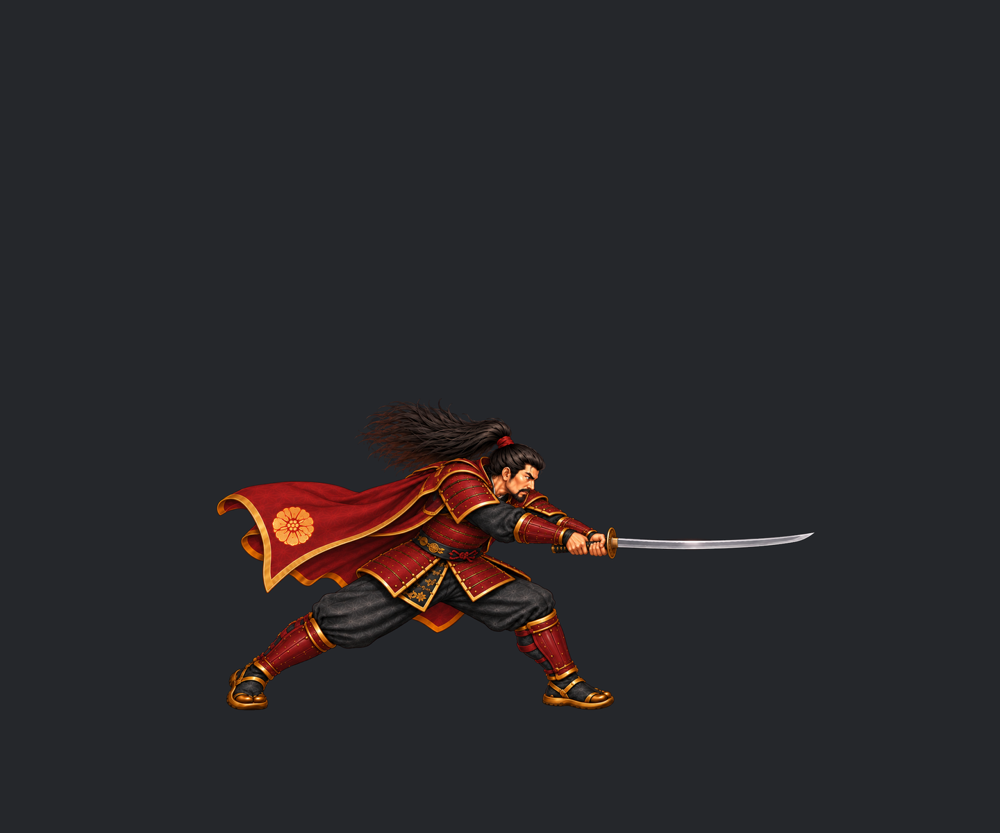 | 跑步銜接前揮、接觸與回正；一般敵人、盾兵與王的判定沿用玩法契約，尚未實測。 | 14 格／600 ms | [核准 GIF](nobunaga/dash_heavy/preview-approved.gif)、[逐格登錄](nobunaga/dash_heavy/delivery-frames.json)、[原生透明 master](nobunaga/dash_heavy/frames-composite) |

## 事件、世界位移與未完成項目

`native_to_preview` 與舊來源叫作 world 的欄位只代表美術預覽；不提供遊戲世界位移，不得重複套用。root／腳／握點／刀角度含手動或影像推估，尚未校準引擎 socket、鏡像或碰撞接點。未知值保留 null，不補造座標。

落地、左手釋放、FX 階段、循環與收招標記均為藝術事件，不等同 hitbox、傷害、敵人附著或已驗證的 gameplay callback。需保留既有遊戲契約，待實際接入後逐項校準。

未完成：引擎／圖集匯入、過濾與 alpha 取樣、換刀 socket、左右向、碰撞與 hitbox／hurtbox、受害者附著、輸入與狀態轉移、重力／位移物理、收招／落地／事件接線、目標尺寸與背景下播放及效能實測。本批未修改 runtime，也未測實體手把、音訊或遊戲平衡。

## 驗證與來源保留

三片與完整 ZIP 的大小／SHA256、CRC、2,367 項包內 SHA、2,368 個來源檔精確複製、16 個 GIF 雜湊與逐格時長、232 格可見 RGBA／alpha 重組與分層互斥均已通過。代表圖抽查滿蓄與反摔；未重做完整人工動作驗收。來源歷史腳本可能仍使用舊 workspace 路徑，不保證全部歷史生成可一鍵重建。

從此目錄執行 `python -X utf8 verify_delivery.py`（Python 3、Pillow、NumPy）。這個入口在原始信長驗證器重算報告後恢復鎖版報告的原始位元組，再查來源 SHA，不改動已核准素材。不要直接執行歷史生成腳本覆寫 master。
