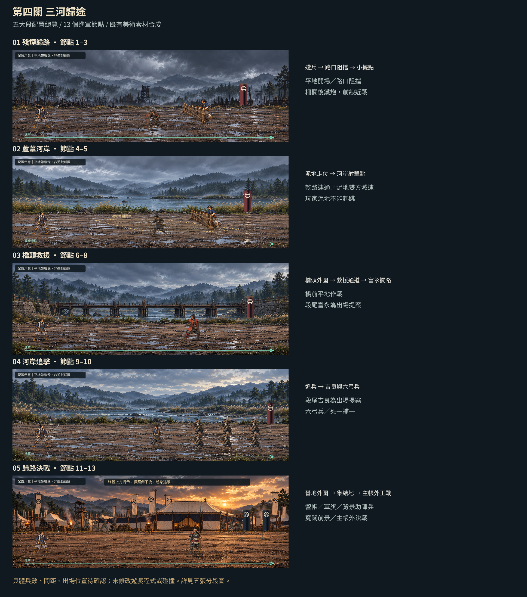

# 第四關「三河歸途」素材交接

本次交付是獨立的素材、動畫事件、設定初值與對接文件。**尚未接入遊戲 runtime；尚未完成人工音訊聽驗、引擎整合測試或實際通關／難度測試。**

由已核對的遠端 main `30fdac0349fb39bd769061318a497446a9ff0114` 建立 `art/stage04-mikawa-handoff-20261017`。提交範圍僅本資料夾；`stage04/` 內的 1,381 個來源檔保持總包原始位元組，未重採樣、重編碼或改寫來源 metadata。

## 最新敵軍增援交接（2026-10-18，尚未實裝）

[新版敵軍增援入口](enemy-reinforcements-20261018/README.md)與 [13 節點 JSON](enemy-reinforcements-20261018/stage04_density_v2.json) 取代舊「2–3 人初值／無增援／僅初始敵清場」規則：初始另計，每節另補 2–3 波，每波左右各 3–4 名，共 33 波；固定排程全關 313 名，吉良護衛替補另計。王先敗退、護衛池及清場條件以新版交接為準。

舊 `stage04/layout/stage4_nodes_proposal.json` 與全部素材保持原樣，供回退；新版僅為待實作設計，9 個 runtime ID 映射與 15 項實測案例仍待完成。本頁原素材檔數及 `VALIDATION.json` 是 2026-10-17 的原始交付紀錄，不包含這次獨立增補；新版靜態核對另見 [PUBLISH_VALIDATION.json](enemy-reinforcements-20261018/PUBLISH_VALIDATION.json)。

## 閱讀順序

1. [版本入口與覆蓋順序](stage04/manifest.json)、[完整交接說明](stage04/README_CODEX.md)、[未決項](stage04/OPEN_ITEMS.json)。各角色與旗幟的幀數、每格時間可不同，請逐動作讀取，不套用固定格數或統一 FPS。
2. [戰鬥接線規則](stage04/settings/combat_handoff.txt)、[長照設定](stage04/settings/udono_combat.json)、[盾兵規則](stage04/settings/shield_combat_rules.json)、[吉良箭雨](stage04/settings/kira_rain.json)。事件資料、角色／武器／VFX 分層與掛點均依目前入口；設定數字是未量測的整合初值。
3. [13 段進軍節點](stage04/layout/stage4_nodes_proposal.json)、[節點表](stage04/layout/stage4_node_table.md)與 [layout](stage04/layout/layout.json)。預覽與 reference_assets 為構圖參照，不是已接線的碰撞或場景資料。
4. [武將呼喊對照](stage04/audio/voice_animation_map_v3.json)、[SFX 路由](stage04/audio/stage4_sfx_routes.json)、[音樂設定](stage04/audio/music/music_map.json)。背景助陣以 [crowd manifest](stage04/audio/crowd/manifest.json) 與 [動畫事件](stage04/backgrounds/crowd/animation_events.json) 為準；每次只播一組、全域至少間隔 2 秒、播放 gain 0.65。

`audio/AUDIO_HANDOFF_REPORT.md` 與各音庫原始審計是保留的製作快照；其中群眾聲音「尚未收到」的敘述早於本包補件。本包已含 `audio/crowd/`，以根 manifest 選定的新版資料為準。preview、source、raw 與來源生成腳本供審閱和追溯，不應自動載入遊戲；本次未執行包內腳本。

## 來源與授權

指定來源：Library `libfile_215b3d0d991c81919c31a9a9f7f7ab37` 的 `Stage04-complete-art-handoff.zip`，294,153,264 bytes。總包 SHA-256：

`3773b6ee4d2ed83d74193a0733a684c6ee6fb5fc58f22b0bce8fb734acf8707c`

總 ZIP 與主題分包均不加入 Git；可由 [Library 下載同一總包](https://chatgpt.com/api/library/files/libfile_215b3d0d991c81919c31a9a9f7f7ab37/download)。

百折不撓音檔未包含，維持 **SOURCE_REQUIRED**。僅保留 [官方來源與依賴記錄](stage04/audio/music/external_dependency.json)、[下載匯入說明](stage04/audio/music/README.txt)及本機匯入工具；本次未下載或匯入該音樂。資料夾內 `.gitignore` 明確排除其預定輸出路徑，避免日後本機匯入後誤加入公開 Git。

PeriTune 的 CC BY 4.0 作者、作品、來源與修改說明保留於 [CREDITS.txt](stage04/audio/music/CREDITS.txt)；[授權稽核](stage04/audio/music/docs/LICENSE_AUDIT.txt)與各音效資料夾內的 Kenney CC0／來源授權文件完整保留。本次未另行變更授權或宣稱完成法律審查。

## 本輪實際驗證

- ZIP 大小、SHA-256、全部項目 CRC、路徑穿越、大小寫／Unicode 路徑衝突、symlink 與巢狀壓縮檔檢查通過。
- 89 份來源 JSON 可解析，根 manifest 指定的元件檔案均存在；主 SHA256SUMS 的 1,375 筆全部相符，另保留 6 份 checksum 文件。來源音庫可對應至本包的 checksum 均逐一比對，300 個既有音訊審計雜湊及 4 個隨包音樂雜湊相符。
- 828 個圖片、共 1,101 個畫格成功解碼；374 個 WAV／OGG／MP3 全部成功解碼且數值有限。除下述 2 首來源音樂外，其餘 372 個音訊均無達到 full scale 的樣本。
- `s04_final_boss_loop.ogg` 的解碼 peak +0.498 dBFS（71 個樣本達 full scale），`s04_victory_return_once.ogg` 為 +0.347 dBFS（10 個）。保留官方來源位元組；按既有 music_map 的 -9.56／-5.95 dB 播放時，單軌 sample peak 約 -9.06／-5.60 dBFS。未驗收疊音後的音量、true peak 或聽感。
- 未發現本輪規則掃描涵蓋的私鑰、GitHub token、AWS key、API secret、簽名下載網址或明文長憑證。最大單檔 12,918,986 bytes，所有檔案均低於 GitHub 100 MiB 單檔上限。

機器檢查摘要見 [VALIDATION.json](VALIDATION.json)，交付資料夾逐檔雜湊見 [SHA256SUMS.txt](SHA256SUMS.txt)。`source_inventory.json` 及 `audio/source_docs/` 的早期 ZIP／原始 Foley 清單是來源追溯快照；未隨包提供的歷史檔案未重新下載或核驗，不能將它們誤報為本次已驗證來源 ZIP。此次只核對可用來源與本包實際檔案。

人工音訊聽驗、日文實際發聲核對、引擎內美術排序／碰撞／事件回呼／混音、六武將與雙人戰鬥、通關及平衡驗收均未做。素材存在不表示這些功能已實作或驗收。
