# 信長以外已核准素材總交接

2026-10-15。**本多、秀吉、家康、顯如各16招全部accepted，共64招。** 使用者最新明確核准覆蓋原包歷史審閱標記；原始文件與來源位元組完整保留。阿市17招沿用 [PR #5](https://github.com/guderian44444/sengoku-m1/pull/5)，本分支不重複上傳。信長不在本批範圍。

## 範圍與版本

本分支從遠端main的966cf8c3建立；原工作區的兩個未發布提交與未提交修改均未帶入。原包展開為 [四角色來源目錄](../deliveries/accepted-four-heroes-20261015)，9007檔全部保留，最大單檔6,108,733 bytes；原ZIP保留本機及Library，未將大ZIP放入Git，也未新增LFS。

來源中的舊candidate／待審／preview_ready／accepted_by_user:false是歷史快照，現況請讀 [ACCEPTED_ACTIONS.json](../deliveries/accepted-four-heroes-20261015/ACCEPTED_ACTIONS.json) 與各角色CURRENT_STATUS.md。素材accepted不等於已接runtime或完成遊戲驗收。

## 來源包與鎖定修訂

### 本多忠勝 — accepted／16招

- 原包：`tadakatsu_newspec_complete_20261015_r3.zip`（92,276,393 bytes；651檔）。
- Library：`libfile_6ecf136829048191a56eda55d1eaab87`；完整ZIP版本：r3檔名鎖定。
- SHA256：`9e62f480e0bc9f783a8d4590d94037373968116a394dcd34fd4024e4874630cb`。
- 採用原包manifest指定版本：第三段單手斜挑、滿蓄固定朝向和腳步轉槍、空輕前戳；不回退舊全身旋轉或空輕橫掃。
- [目前狀態](../deliveries/accepted-four-heroes-20261015/tadakatsu/CURRENT_STATUS.md) · [原招式／修訂文件](../deliveries/accepted-four-heroes-20261015/tadakatsu/source/招式文件.md) · [原交接文件](../deliveries/accepted-four-heroes-20261015/tadakatsu/source/HANDOFF.md) · [原選版索引](../deliveries/accepted-four-heroes-20261015/tadakatsu/source/manifest.json)

### 秀吉 — accepted／16招

- 原包：`hideyoshi_newspec_head95_complete.zip`（127,325,743 bytes；1972檔）。
- Library：`libfile_559ef347385c8191abfb773801f17397`；完整ZIP版本：6。
- SHA256：`7b1f9d3b24b2c6214b6f426a283b8f69a9b5a779d6d8cad89614e5f6ad3ee21f`。
- 頭部95%。旋斬採charge_release_fastburst_v8，動作／FX版本v8、GIF Library版本7、完整ZIP Library版本6，三者不可混用。人物17格1240ms，預覽28格1440ms含獨立FX與示意敵人尾段，未新增傷害事件。
- [目前狀態](../deliveries/accepted-four-heroes-20261015/hideyoshi/CURRENT_STATUS.md) · [原招式／修訂文件](../deliveries/accepted-four-heroes-20261015/hideyoshi/source/hideyoshi_newspec_20261015/MOVE_REVIEW.md) · [原交接文件](../deliveries/accepted-four-heroes-20261015/hideyoshi/source/hideyoshi_newspec_20261015/HANDOFF.md) · [原選版索引](../deliveries/accepted-four-heroes-20261015/hideyoshi/source/hideyoshi_newspec_20261015/review_manifest.json)

### 家康06 — accepted／16招

- 原包：`Ieyasu_NewCombat_16Actions_Candidate_20261015_06.zip`（218,722,339 bytes；2340檔）。
- Library：`libfile_b1b48ed5645881918299dd3a36071637`；完整ZIP版本：5。
- SHA256：`b18ed188a47aec6c3413af4f684325a94486619c8c45507a622b8d7ee78f15ef`。
- 採06灰白陣羽織／深藍袖身份，蓄力三段採最新一閃，不採history內舊旋斬。ready6格900ms、hold1格示範400ms、release12格800ms；前向穿透每敵人最多一次、命中倒地，殘影無傷害。
- [目前狀態](../deliveries/accepted-four-heroes-20261015/ieyasu/CURRENT_STATUS.md) · [原招式／修訂文件](../deliveries/accepted-four-heroes-20261015/ieyasu/source/Ieyasu_NewCombat_16Actions/招式文件.md) · [原交接文件](../deliveries/accepted-four-heroes-20261015/ieyasu/source/Ieyasu_NewCombat_16Actions/交接文件.md) · [原選版索引](../deliveries/accepted-four-heroes-20261015/ieyasu/source/Ieyasu_NewCombat_16Actions/ACTION_INDEX.json)

### 本願寺顯如03 — accepted／16招

- 原包：`kennyo03_snapshot_20261015_v6_full_sources.zip`（387,959,097 bytes；4044檔）。
- Library：`libfile_109cc2a34d0881918153702c9edfbec2`；完整ZIP版本：2。
- SHA256：`3b737f9d0da9708e904a82ba525076ae535344afdca0167e7a3fa608a2740710`。
- 採03白頭巾身份及v6完整快照。空重採air_heavy_continuous_15f_v5，15格950ms乾淨單次連貫版；滿蓄放開採柔性念珠三輪六擊與獨立正立卍字投射，不回退舊頭頂旋杖。
- [目前狀態](../deliveries/accepted-four-heroes-20261015/kennyo/CURRENT_STATUS.md) · [原招式／修訂文件](../deliveries/accepted-four-heroes-20261015/kennyo/source/sources/USER_OVERRIDES.md) · [原交接文件](../deliveries/accepted-four-heroes-20261015/kennyo/source/sources/README_DELIVERY.md) · [原選版索引](../deliveries/accepted-four-heroes-20261015/kennyo/source/manifest.json)

## 分層、事件與接入

每招依採用metadata的逐格duration播放，不固定6格或等時；實際GIF編碼可合併重複姿勢，不能用GIF格數代替人物播放格數。人物body／body_canvas、完整武器與鞘、手部遮擋、FX與被投者各自獨立。腳點／root、握點和前後層保留原座標空間，角色縮放時一致換算，不按每張bbox等高。

命中、抽回倒地、放箭／拔刀、投摔放手與落地按事件處理；每段輕手及兩次抓中打擊各自輸入。待機保持、單次前進和左向收勢依來源說明銜接，不將預覽循環重設當成世界位移。

此PR只交付素材、來源、招式說明與驗證，不修改game或認證。尚未在runtime驗收碰撞、傷害、取消窗、受擊中斷、Boss抗性、世界阻擋與實體手把。歷史來源中的絕對製作路徑僅供追溯；目前入口全用repo相對連結。

## 64招accepted代表圖與說明

### 本多忠勝：16招accepted

| 動作／目前修訂 | 人物格數／時長 | 代表圖 | 動作說明與檔案 |
| --- | --- | --- | --- |
| `light_1` · accepted main/light_1 | 5／610ms | 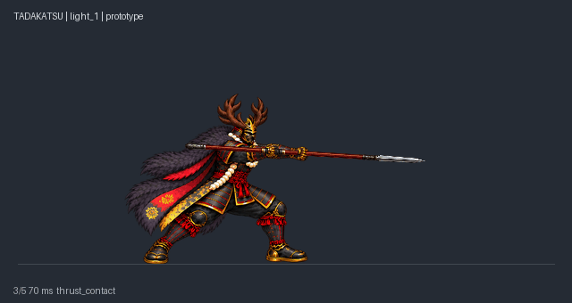 | 雙手短收，前踏推出長槍並收回。 [正常速度GIF](../deliveries/accepted-four-heroes-20261015/tadakatsu/source/review/01_light_1.gif) · [metadata](../deliveries/accepted-four-heroes-20261015/tadakatsu/source/main/light_1/metadata.json) · [來源](../deliveries/accepted-four-heroes-20261015/tadakatsu/source/main/light_1) |
| `light_2` · accepted main/light_2 | 6／620ms | 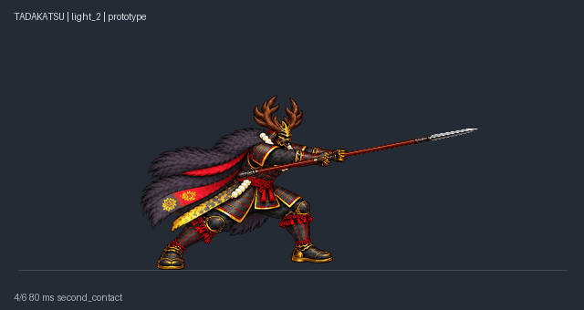 | 再前踏刺擊，回共同待機，保持連段前移。 [正常速度GIF](../deliveries/accepted-four-heroes-20261015/tadakatsu/source/review/02_light_2.gif) · [metadata](../deliveries/accepted-four-heroes-20261015/tadakatsu/source/main/light_2/metadata.json) · [來源](../deliveries/accepted-four-heroes-20261015/tadakatsu/source/main/light_2) |
| `light_3` · accepted main/light_3_v5 | 8／780ms | 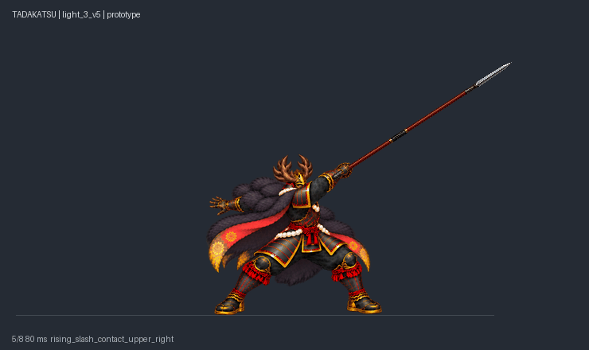 | 右手單手握近槍尾，左手放開平衡；肩腰由畫面左下帶起向右上斜挑，起收銜接共用待機。 [正常速度GIF](../deliveries/accepted-four-heroes-20261015/tadakatsu/source/review/03_light_3.gif) · [metadata](../deliveries/accepted-four-heroes-20261015/tadakatsu/source/main/light_3_v5/metadata.json) · [來源](../deliveries/accepted-four-heroes-20261015/tadakatsu/source/main/light_3_v5) |
| `heavy` · accepted main/heavy_v2 | 8／1040ms | 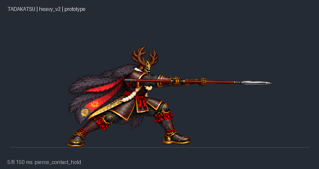 | 較長準備，穿透接觸與抽槍分開；抽回事件才倒地。 [正常速度GIF](../deliveries/accepted-four-heroes-20261015/tadakatsu/source/review/04_heavy.gif) · [metadata](../deliveries/accepted-four-heroes-20261015/tadakatsu/source/main/heavy_v2/metadata.json) · [來源](../deliveries/accepted-four-heroes-20261015/tadakatsu/source/main/heavy_v2) |
| `charge_ready` · accepted main/charge_ready | 6／870ms | 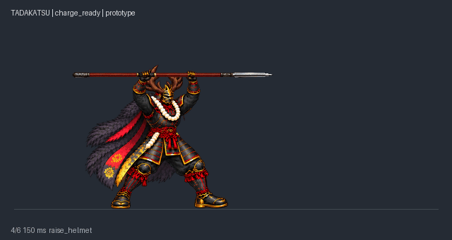 | 雙手逐步把整槍高舉至鹿角上方。 [正常速度GIF](../deliveries/accepted-four-heroes-20261015/tadakatsu/source/review/05_charge_ready.gif) · [metadata](../deliveries/accepted-four-heroes-20261015/tadakatsu/source/main/charge_ready/metadata.json) · [來源](../deliveries/accepted-four-heroes-20261015/tadakatsu/source/main/charge_ready) |
| `charge_hold` · accepted main/charge_hold | 1／800ms | 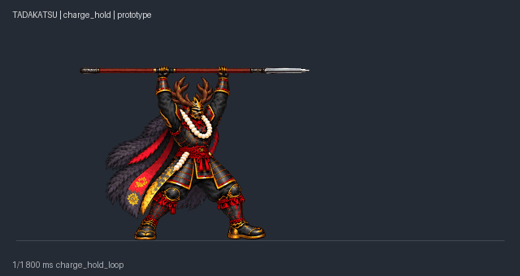 | 單格穩定停留，等待玩家放開；不是多格呼吸動畫。 [正常速度GIF](../deliveries/accepted-four-heroes-20261015/tadakatsu/source/review/06_charge_hold.gif) · [metadata](../deliveries/accepted-four-heroes-20261015/tadakatsu/source/main/charge_hold/metadata.json) · [來源](../deliveries/accepted-four-heroes-20261015/tadakatsu/source/main/charge_hold) |
| `charge_release` · accepted main/charge_release_v3 | 19／1370ms | 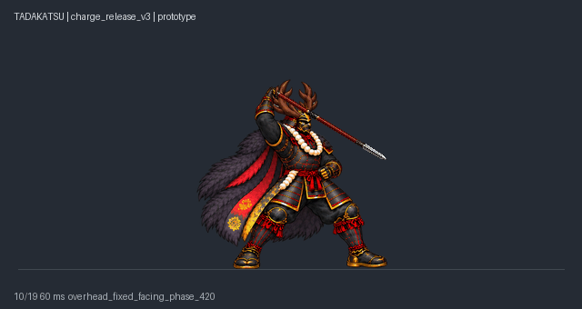 | 固定腳步與朝向，單手握槍尾頭頂兩圈；肩軀幹微擺發力，按最新使用者指示覆蓋整人旋轉規格。 [正常速度GIF](../deliveries/accepted-four-heroes-20261015/tadakatsu/source/review/07_charge_release.gif) · [metadata](../deliveries/accepted-four-heroes-20261015/tadakatsu/source/main/charge_release_v3/metadata.json) · [來源](../deliveries/accepted-four-heroes-20261015/tadakatsu/source/main/charge_release_v3) |
| `air_light` · accepted air_light | 12／720ms | 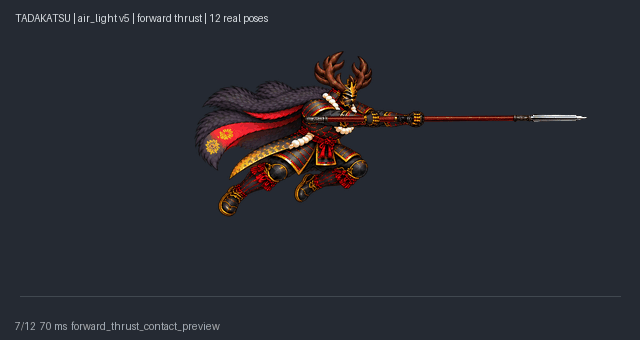 | 空中握持長槍、向前戳、收回下降；全程槍尖朝前，不再繞背或橫掃大轉身。 [正常速度GIF](../deliveries/accepted-four-heroes-20261015/tadakatsu/source/review/08_air_light.gif) · [metadata](../deliveries/accepted-four-heroes-20261015/tadakatsu/source/air_light/metadata.json) · [來源](../deliveries/accepted-four-heroes-20261015/tadakatsu/source/air_light) |
| `air_heavy` · accepted air_heavy | 8／720ms | 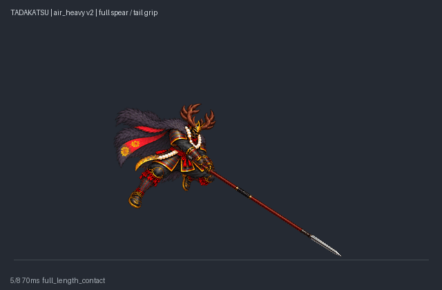 | 空中前揮與下劈時握近槍尾，全槍伸出；落地前回收，避免槍尖穿地。 [正常速度GIF](../deliveries/accepted-four-heroes-20261015/tadakatsu/source/review/09_air_heavy.gif) · [metadata](../deliveries/accepted-four-heroes-20261015/tadakatsu/source/air_heavy/metadata.json) · [來源](../deliveries/accepted-four-heroes-20261015/tadakatsu/source/air_heavy) |
| `grab_start` · accepted grabs/grab_start | 6／640ms | 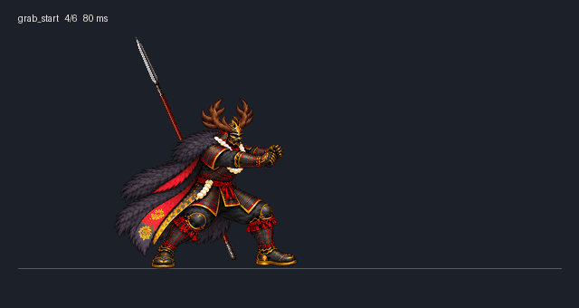 | 空手抓衣領或上臂拉近，長槍安全留後層。 [正常速度GIF](../deliveries/accepted-four-heroes-20261015/tadakatsu/source/review/10_grab_start.gif) · [metadata](../deliveries/accepted-four-heroes-20261015/tadakatsu/source/grabs/grab_start/metadata.json) · [來源](../deliveries/accepted-four-heroes-20261015/tadakatsu/source/grabs/grab_start) |
| `grab_hold` · accepted grabs/grab_hold | 6／900ms | 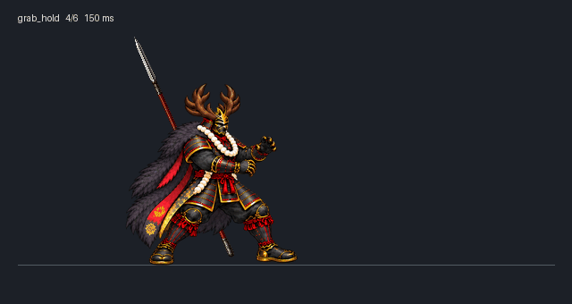 | 穩定抓持，可循環等待後續輸入。 [正常速度GIF](../deliveries/accepted-four-heroes-20261015/tadakatsu/source/review/11_grab_hold.gif) · [metadata](../deliveries/accepted-four-heroes-20261015/tadakatsu/source/grabs/grab_hold/metadata.json) · [來源](../deliveries/accepted-four-heroes-20261015/tadakatsu/source/grabs/grab_hold) |
| `grab_hit_1` · accepted grabs/grab_hit_1 | 9／780ms | 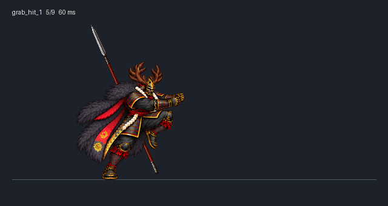 | 單腳支撐抬膝接觸，再回抓持。 [正常速度GIF](../deliveries/accepted-four-heroes-20261015/tadakatsu/source/review/12_grab_hit_1.gif) · [metadata](../deliveries/accepted-four-heroes-20261015/tadakatsu/source/grabs/grab_hit_1/metadata.json) · [來源](../deliveries/accepted-four-heroes-20261015/tadakatsu/source/grabs/grab_hit_1) |
| `grab_hit_2` · accepted grabs/grab_hit_2 | 9／600ms | 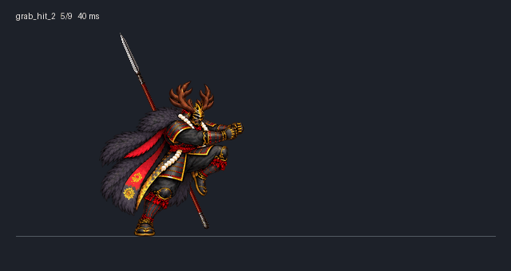 | 與第一膝擊共用同套9張人物姿勢，以600ms獨立播放；knee_contact_2在250ms，不自動雙連。 [正常速度GIF](../deliveries/accepted-four-heroes-20261015/tadakatsu/source/review/13_grab_hit_2.gif) · [metadata](../deliveries/accepted-four-heroes-20261015/tadakatsu/source/grabs/grab_hit_2/metadata.json) · [來源](../deliveries/accepted-four-heroes-20261015/tadakatsu/source/grabs/grab_hit_2) |
| `throw_forward` · accepted grabs/throw_forward | 9／880ms | 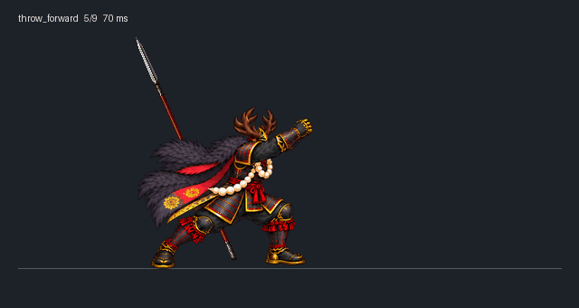 | 雙臂與腰髖向前拋出，張手時釋放對手。 [正常速度GIF](../deliveries/accepted-four-heroes-20261015/tadakatsu/source/review/14_throw_forward.gif) · [metadata](../deliveries/accepted-four-heroes-20261015/tadakatsu/source/grabs/throw_forward/metadata.json) · [來源](../deliveries/accepted-four-heroes-20261015/tadakatsu/source/grabs/throw_forward) |
| `throw_reverse` · accepted grabs/throw_reverse | 9／920ms | 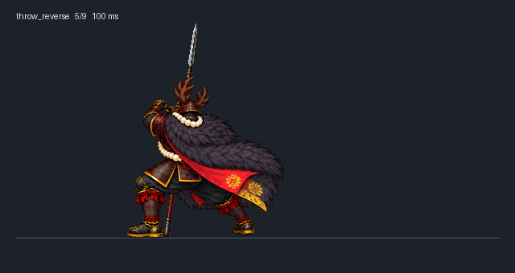 | 真側背身轉向與過肩反拋，非前投倒播。 [正常速度GIF](../deliveries/accepted-four-heroes-20261015/tadakatsu/source/review/15_throw_reverse.gif) · [metadata](../deliveries/accepted-four-heroes-20261015/tadakatsu/source/grabs/throw_reverse/metadata.json) · [來源](../deliveries/accepted-four-heroes-20261015/tadakatsu/source/grabs/throw_reverse) |
| `dash_heavy` · accepted main/dash_heavy_v2 | 8／670ms | 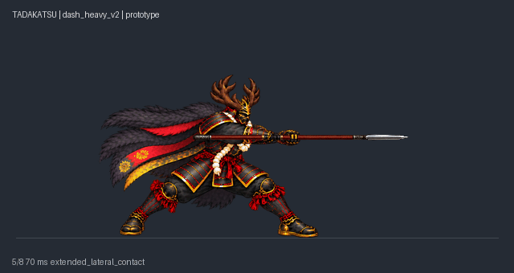 | 新增3張跑重橫掃姿勢，雙臂與長槍更前伸，8格670ms。 [正常速度GIF](../deliveries/accepted-four-heroes-20261015/tadakatsu/source/review/16_dash_heavy.gif) · [metadata](../deliveries/accepted-four-heroes-20261015/tadakatsu/source/main/dash_heavy_v2/metadata.json) · [來源](../deliveries/accepted-four-heroes-20261015/tadakatsu/source/main/dash_heavy_v2) |

### 秀吉：16招accepted

| 動作／目前修訂 | 人物格數／時長 | 代表圖 | 動作說明與檔案 |
| --- | --- | --- | --- |
| `light_1` · accepted downcut10_scale_registration_v6 | 10／700ms |  | 前跨落地時雙手下切，肩背胸與重心隨刀往前下跟進，後腳跟上收勢。 [正常速度GIF](../deliveries/accepted-four-heroes-20261015/hideyoshi/source/hideyoshi_newspec_20261015/actions/light_1/light_1_10.gif) · [metadata](../deliveries/accepted-four-heroes-20261015/hideyoshi/source/hideyoshi_newspec_20261015/actions/light_1/metadata.json) · [來源](../deliveries/accepted-four-heroes-20261015/hideyoshi/source/hideyoshi_newspec_20261015/actions/light_1) |
| `light_2` · accepted horizontal_torso_turn_v4_scale_calibrated | 8／590ms |  | 雙手腰側蓄勢，前跨帶腰肩胸水平橫斬，側背隨刀旋轉後收勢。 [正常速度GIF](../deliveries/accepted-four-heroes-20261015/hideyoshi/source/hideyoshi_newspec_20261015/actions/light_2/light_2.gif) · [metadata](../deliveries/accepted-four-heroes-20261015/hideyoshi/source/hideyoshi_newspec_20261015/actions/light_2/metadata.json) · [來源](../deliveries/accepted-four-heroes-20261015/hideyoshi/source/hideyoshi_newspec_20261015/actions/light_2) |
| `light_3` · accepted fastlow_scale_corrected_v4 | 11／680ms |  | 第三段保持前跨與胸肩前向發力，實際下斬加速並壓低雙手握點與刀斬高度；命中擊飛後後腳跟進，總時長保持680ms。 [正常速度GIF](../deliveries/accepted-four-heroes-20261015/hideyoshi/source/hideyoshi_newspec_20261015/actions/light_3_scale_v4/light_3_scale_v4.gif) · [metadata](../deliveries/accepted-four-heroes-20261015/hideyoshi/source/hideyoshi_newspec_20261015/actions/light_3_scale_v4/metadata.json) · [來源](../deliveries/accepted-four-heroes-20261015/hideyoshi/source/hideyoshi_newspec_20261015/actions/light_3_scale_v4) |
| `heavy` · accepted step12_fastswing_v5_scale_calibrated | 12／950ms |  | 翻腕轉刃向上、前跨蓄勢，快速上撩擊飛；12格950ms，揮動段180ms。 [正常速度GIF](../deliveries/accepted-four-heroes-20261015/hideyoshi/source/hideyoshi_newspec_20261015/actions/heavy_step12_v4/heavy_edgeup.gif) · [metadata](../deliveries/accepted-four-heroes-20261015/hideyoshi/source/hideyoshi_newspec_20261015/actions/heavy_step12_v4/metadata.json) · [來源](../deliveries/accepted-four-heroes-20261015/hideyoshi/source/hideyoshi_newspec_20261015/actions/heavy_step12_v4) |
| `charge_ready` · accepted twohand_head95 | 6／680ms |  | 雙手近身收刀，雙腳逐步開馬步下沉；腰前金扇收納，刀留在腰側安全位置。 [正常速度GIF](../deliveries/accepted-four-heroes-20261015/hideyoshi/source/hideyoshi_newspec_20261015/actions/charge_ready/charge_ready.gif) · [metadata](../deliveries/accepted-four-heroes-20261015/hideyoshi/source/hideyoshi_newspec_20261015/actions/charge_ready/metadata.json) · [來源](../deliveries/accepted-four-heroes-20261015/hideyoshi/source/hideyoshi_newspec_20261015/actions/charge_ready) |
| `charge_hold` · accepted twohand_head95 | 8／880ms |  | 低馬步保持，雙手握點與腳點固定；腰部集氣提示輕微明暗循環，金扇始終收納。 [正常速度GIF](../deliveries/accepted-four-heroes-20261015/hideyoshi/source/hideyoshi_newspec_20261015/actions/charge_hold/charge_hold.gif) · [metadata](../deliveries/accepted-four-heroes-20261015/hideyoshi/source/hideyoshi_newspec_20261015/actions/charge_hold/metadata.json) · [來源](../deliveries/accepted-four-heroes-20261015/hideyoshi/source/hideyoshi_newspec_20261015/actions/charge_hold) |
| `charge_release` · accepted approved_actor_silver_fastburst_enemy_demo_v8 | 17／1240ms；GIF展示1440ms |  | 末段40ms蓄縮後100ms尖長銀刃爆射，獨立灰色示意敵人向外仰翻擊飛；原人物刀及兩次傷害事件不變。 [正常速度GIF](../deliveries/accepted-four-heroes-20261015/hideyoshi/source/hideyoshi_newspec_20261015/actions/charge_release_fastburst_v8/charge_release_fastburst_v8.gif) · [metadata](../deliveries/accepted-four-heroes-20261015/hideyoshi/source/hideyoshi_newspec_20261015/actions/charge_release_fastburst_v8/metadata.json) · [來源](../deliveries/accepted-four-heroes-20261015/hideyoshi/source/hideyoshi_newspec_20261015/actions/charge_release_fastburst_v8) |
| `air_light` · accepted inplace_scale_v2 | 11／620ms |  | 原地起跳與落地：腰帶／骨盆中心X固定，頭胸校準固有尺度；11格620ms。 [正常速度GIF](../deliveries/accepted-four-heroes-20261015/hideyoshi/source/hideyoshi_newspec_20261015/actions/air_light/air_light_inplace_scale_v2.gif) · [metadata](../deliveries/accepted-four-heroes-20261015/hideyoshi/source/hideyoshi_newspec_20261015/actions/air_light/metadata.json) · [來源](../deliveries/accepted-four-heroes-20261015/hideyoshi/source/hideyoshi_newspec_20261015/actions/air_light) |
| `air_heavy` · accepted forwardstep_scale_v2 | 11／700ms |  | 前進一步空中落斬：骨盆沿連續前進弧線移動36px，落地後不退回；頭胸校準固有尺度。 [正常速度GIF](../deliveries/accepted-four-heroes-20261015/hideyoshi/source/hideyoshi_newspec_20261015/actions/air_heavy/air_heavy_forwardstep_scale_v2.gif) · [metadata](../deliveries/accepted-four-heroes-20261015/hideyoshi/source/hideyoshi_newspec_20261015/actions/air_heavy/metadata.json) · [來源](../deliveries/accepted-four-heroes-20261015/hideyoshi/source/hideyoshi_newspec_20261015/actions/air_heavy) |
| `grab_start` · accepted head95_game150_nobottle | 5／520ms |  | 雙手抓住並拉近對手。 [正常速度GIF](../deliveries/accepted-four-heroes-20261015/hideyoshi/source/hideyoshi_newspec_20261015/grabs/normalized/grab_start/hideyoshi_grab_start_head95_game150_nobottle.gif) · [metadata](../deliveries/accepted-four-heroes-20261015/hideyoshi/source/hideyoshi_newspec_20261015/grabs/normalized/grab_start/metadata.json) · [來源](../deliveries/accepted-four-heroes-20261015/hideyoshi/source/hideyoshi_newspec_20261015/grabs/normalized/grab_start) |
| `grab_hold` · accepted head95_game150_nobottle | 1／600ms |  | 維持抓點等待膝擊或投摔。 [正常速度GIF](../deliveries/accepted-four-heroes-20261015/hideyoshi/source/hideyoshi_newspec_20261015/grabs/normalized/grab_hold/hideyoshi_grab_hold_head95_game150_nobottle.gif) · [metadata](../deliveries/accepted-four-heroes-20261015/hideyoshi/source/hideyoshi_newspec_20261015/grabs/normalized/grab_hold/metadata.json) · [來源](../deliveries/accepted-four-heroes-20261015/hideyoshi/source/hideyoshi_newspec_20261015/grabs/normalized/grab_hold) |
| `grab_hit_1` · accepted twohand_head95_game150 | 5／490ms |  | 拉住對手膝擊後回到保持；兩次接觸事件獨立。 [正常速度GIF](../deliveries/accepted-four-heroes-20261015/hideyoshi/source/hideyoshi_newspec_20261015/grabs/normalized/grab_hit_1/hideyoshi_grab_hit_1_head95_game150.gif) · [metadata](../deliveries/accepted-four-heroes-20261015/hideyoshi/source/hideyoshi_newspec_20261015/grabs/normalized/grab_hit_1/metadata.json) · [來源](../deliveries/accepted-four-heroes-20261015/hideyoshi/source/hideyoshi_newspec_20261015/grabs/normalized/grab_hit_1) |
| `grab_hit_2` · accepted twohand_head95_game150 | 5／480ms |  | 拉住對手膝擊後回到保持；兩次接觸事件獨立。 [正常速度GIF](../deliveries/accepted-four-heroes-20261015/hideyoshi/source/hideyoshi_newspec_20261015/grabs/normalized/grab_hit_2/hideyoshi_grab_hit_2_head95_game150.gif) · [metadata](../deliveries/accepted-four-heroes-20261015/hideyoshi/source/hideyoshi_newspec_20261015/grabs/normalized/grab_hit_2/metadata.json) · [來源](../deliveries/accepted-four-heroes-20261015/hideyoshi/source/hideyoshi_newspec_20261015/grabs/normalized/grab_hit_2) |
| `throw_forward` · accepted head95_game150_nobottle | 8／820ms |  | 轉髖承肩向前釋放，對手獨立飛出落地。 [正常速度GIF](../deliveries/accepted-four-heroes-20261015/hideyoshi/source/hideyoshi_newspec_20261015/grabs/normalized/throw_forward/hideyoshi_throw_forward_head95_game150_nobottle.gif) · [metadata](../deliveries/accepted-four-heroes-20261015/hideyoshi/source/hideyoshi_newspec_20261015/grabs/normalized/throw_forward/metadata.json) · [來源](../deliveries/accepted-four-heroes-20261015/hideyoshi/source/hideyoshi_newspec_20261015/grabs/normalized/throw_forward) |
| `throw_reverse` · accepted head95_game150_nobottle | 8／840ms |  | 背面轉身承肩，向後方釋放對手。 [正常速度GIF](../deliveries/accepted-four-heroes-20261015/hideyoshi/source/hideyoshi_newspec_20261015/grabs/normalized/throw_reverse/hideyoshi_throw_reverse_head95_game150_nobottle.gif) · [metadata](../deliveries/accepted-four-heroes-20261015/hideyoshi/source/hideyoshi_newspec_20261015/grabs/normalized/throw_reverse/metadata.json) · [來源](../deliveries/accepted-four-heroes-20261015/hideyoshi/source/hideyoshi_newspec_20261015/grabs/normalized/throw_reverse) |
| `dash_heavy` · accepted twohand_head95_scale_calibrated | 8／580ms |  | 奔跑末步壓低重心，雙手快速前橫掃，再以前腳制動回站；一般敵人接觸擊飛。 [正常速度GIF](../deliveries/accepted-four-heroes-20261015/hideyoshi/source/hideyoshi_newspec_20261015/actions/dash_heavy/dash_heavy.gif) · [metadata](../deliveries/accepted-four-heroes-20261015/hideyoshi/source/hideyoshi_newspec_20261015/actions/dash_heavy/metadata.json) · [來源](../deliveries/accepted-four-heroes-20261015/hideyoshi/source/hideyoshi_newspec_20261015/actions/dash_heavy) |

### 家康06：16招accepted

| 動作／目前修訂 | 人物格數／時長 | 代表圖 | 動作說明與檔案 |
| --- | --- | --- | --- |
| `light_1` · accepted 20261015_0156_scale_tuned | 8／720ms |  | 第一段：前踏斜橫斬，接觸推人後回正。 [正常速度GIF](../deliveries/accepted-four-heroes-20261015/ieyasu/source/Ieyasu_NewCombat_16Actions/preview_152px/light_1/normal.gif) · [metadata](../deliveries/accepted-four-heroes-20261015/ieyasu/source/Ieyasu_NewCombat_16Actions/actions/light_1/metadata.json) · [來源](../deliveries/accepted-four-heroes-20261015/ieyasu/source/Ieyasu_NewCombat_16Actions/actions/light_1) |
| `light_2` · accepted 20261015_0156_scale_tuned | 8／760ms |  | 第二段：肩後蓄勢反掃，保留前踏位移。 [正常速度GIF](../deliveries/accepted-four-heroes-20261015/ieyasu/source/Ieyasu_NewCombat_16Actions/preview_152px/light_2/normal.gif) · [metadata](../deliveries/accepted-four-heroes-20261015/ieyasu/source/Ieyasu_NewCombat_16Actions/actions/light_2/metadata.json) · [來源](../deliveries/accepted-four-heroes-20261015/ieyasu/source/Ieyasu_NewCombat_16Actions/actions/light_2) |
| `light_3` · accepted 20261015_0156_scale_tuned | 10／1000ms |  | 第三段：沉肩轉髖大掃，命中擊飛。 [正常速度GIF](../deliveries/accepted-four-heroes-20261015/ieyasu/source/Ieyasu_NewCombat_16Actions/preview_152px/light_3/normal.gif) · [metadata](../deliveries/accepted-four-heroes-20261015/ieyasu/source/Ieyasu_NewCombat_16Actions/actions/light_3/metadata.json) · [來源](../deliveries/accepted-four-heroes-20261015/ieyasu/source/Ieyasu_NewCombat_16Actions/actions/light_3) |
| `heavy` · accepted 20261015_0156_scale_tuned | 10／1140ms |  | 普通重手：收刀、分段拔刀後水平前突；刀鞘留腰側。 [正常速度GIF](../deliveries/accepted-four-heroes-20261015/ieyasu/source/Ieyasu_NewCombat_16Actions/preview_152px/heavy/normal.gif) · [metadata](../deliveries/accepted-four-heroes-20261015/ieyasu/source/Ieyasu_NewCombat_16Actions/actions/heavy/metadata.json) · [來源](../deliveries/accepted-four-heroes-20261015/ieyasu/source/Ieyasu_NewCombat_16Actions/actions/heavy) |
| `charge_ready` · accepted 20261015_0256_issen_approved | 6／900ms |  | 一閃蓄勢：右手握柄、左手鞘口，刀鞘朝後，慢收刀並屈膝壓低。 [正常速度GIF](../deliveries/accepted-four-heroes-20261015/ieyasu/source/Ieyasu_NewCombat_16Actions/preview_152px/charge_ready/normal.gif) · [metadata](../deliveries/accepted-four-heroes-20261015/ieyasu/source/Ieyasu_NewCombat_16Actions/actions/charge_ready/metadata.json) · [來源](../deliveries/accepted-four-heroes-20261015/ieyasu/source/Ieyasu_NewCombat_16Actions/actions/charge_ready) |
| `charge_hold` · accepted 20261015_0256_issen_approved | 1／400ms |  | 一閃保持：完全入鞘、低姿待發；示範保持400ms，遊戲由放鍵決定。 [正常速度GIF](../deliveries/accepted-four-heroes-20261015/ieyasu/source/Ieyasu_NewCombat_16Actions/preview_152px/charge_hold/normal.gif) · [metadata](../deliveries/accepted-four-heroes-20261015/ieyasu/source/Ieyasu_NewCombat_16Actions/actions/charge_hold/metadata.json) · [來源](../deliveries/accepted-four-heroes-20261015/ieyasu/source/Ieyasu_NewCombat_16Actions/actions/charge_hold) |
| `charge_release` · accepted 20261015_0256_issen_approved | 12／800ms |  | 一閃施放：瞬間拔刀、三步前衝，關鍵踏步各100ms；末段水平前指停留；大型劍氣前向穿透、沿路敵人倒地，殘影／劍氣／量測敵人皆獨立層。 [正常速度GIF](../deliveries/accepted-four-heroes-20261015/ieyasu/source/Ieyasu_NewCombat_16Actions/preview_152px/charge_release/normal.gif) · [metadata](../deliveries/accepted-four-heroes-20261015/ieyasu/source/Ieyasu_NewCombat_16Actions/actions/charge_release/metadata.json) · [來源](../deliveries/accepted-four-heroes-20261015/ieyasu/source/Ieyasu_NewCombat_16Actions/actions/charge_release) |
| `air_light` · accepted 20261015_0156_scale_tuned | 8／660ms |  | 空中輕手：起跳後主武近距離揮斬，下降落地。 [正常速度GIF](../deliveries/accepted-four-heroes-20261015/ieyasu/source/Ieyasu_NewCombat_16Actions/preview_152px/air_light/normal.gif) · [metadata](../deliveries/accepted-four-heroes-20261015/ieyasu/source/Ieyasu_NewCombat_16Actions/actions/air_light/metadata.json) · [來源](../deliveries/accepted-four-heroes-20261015/ieyasu/source/Ieyasu_NewCombat_16Actions/actions/air_light) |
| `air_heavy` · accepted 20261015_0156_scale_tuned | 12／850ms |  | 空中重手：跳起向前一步52px、深下斬後低馬步落地，回收不滑回原點。 [正常速度GIF](../deliveries/accepted-four-heroes-20261015/ieyasu/source/Ieyasu_NewCombat_16Actions/preview_152px/air_heavy/normal.gif) · [metadata](../deliveries/accepted-four-heroes-20261015/ieyasu/source/Ieyasu_NewCombat_16Actions/actions/air_heavy/metadata.json) · [來源](../deliveries/accepted-four-heroes-20261015/ieyasu/source/Ieyasu_NewCombat_16Actions/actions/air_heavy) |
| `grab_start` · accepted 20261015_0156_scale_tuned | 6／600ms |  | 抓起：收刀安全收納、伸手閉握、拉近。 [正常速度GIF](../deliveries/accepted-four-heroes-20261015/ieyasu/source/Ieyasu_NewCombat_16Actions/preview_152px/grab_start/normal.gif) · [metadata](../deliveries/accepted-four-heroes-20261015/ieyasu/source/Ieyasu_NewCombat_16Actions/grabs/registration.json) · [來源](../deliveries/accepted-four-heroes-20261015/ieyasu/source/Ieyasu_NewCombat_16Actions/grabs) |
| `grab_hold` · accepted 20261015_0156_scale_tuned | 6／600ms |  | 抓握保持：固定衣領／上臂接點。 [正常速度GIF](../deliveries/accepted-four-heroes-20261015/ieyasu/source/Ieyasu_NewCombat_16Actions/preview_152px/grab_hold/normal.gif) · [metadata](../deliveries/accepted-four-heroes-20261015/ieyasu/source/Ieyasu_NewCombat_16Actions/grabs/registration.json) · [來源](../deliveries/accepted-four-heroes-20261015/ieyasu/source/Ieyasu_NewCombat_16Actions/grabs) |
| `grab_hit_1` · accepted 20261015_0156_scale_tuned | 6／600ms |  | 第一頭槌：採用已選第二下的同套姿勢與600ms節奏；獨立第一下輸入與命中。 [正常速度GIF](../deliveries/accepted-four-heroes-20261015/ieyasu/source/Ieyasu_NewCombat_16Actions/preview_152px/grab_hit_1/normal.gif) · [metadata](../deliveries/accepted-four-heroes-20261015/ieyasu/source/Ieyasu_NewCombat_16Actions/grabs/registration.json) · [來源](../deliveries/accepted-four-heroes-20261015/ieyasu/source/Ieyasu_NewCombat_16Actions/grabs) |
| `grab_hit_2` · accepted 20261015_0156_scale_tuned | 6／600ms |  | 第二頭槌：與第一下共用已選姿勢，600ms；獨立第二下輸入與命中，不自動兩連擊。 [正常速度GIF](../deliveries/accepted-four-heroes-20261015/ieyasu/source/Ieyasu_NewCombat_16Actions/preview_152px/grab_hit_2/normal.gif) · [metadata](../deliveries/accepted-four-heroes-20261015/ieyasu/source/Ieyasu_NewCombat_16Actions/grabs/registration.json) · [來源](../deliveries/accepted-four-heroes-20261015/ieyasu/source/Ieyasu_NewCombat_16Actions/grabs) |
| `throw_forward` · accepted 20261015_0156_scale_tuned | 13／1000ms |  | 前摔：轉髖前拋，轉髖後鬆手，被投者獨立飛出。 [正常速度GIF](../deliveries/accepted-four-heroes-20261015/ieyasu/source/Ieyasu_NewCombat_16Actions/preview_152px/throw_forward/normal.gif) · [metadata](../deliveries/accepted-four-heroes-20261015/ieyasu/source/Ieyasu_NewCombat_16Actions/grabs/registration.json) · [來源](../deliveries/accepted-four-heroes-20261015/ieyasu/source/Ieyasu_NewCombat_16Actions/grabs) |
| `throw_reverse` · accepted 20261015_0156_scale_tuned | 12／1100ms |  | 反摔：轉背上肩、反向過肩釋放，最後左向站穩。 [正常速度GIF](../deliveries/accepted-four-heroes-20261015/ieyasu/source/Ieyasu_NewCombat_16Actions/preview_152px/throw_reverse/normal.gif) · [metadata](../deliveries/accepted-four-heroes-20261015/ieyasu/source/Ieyasu_NewCombat_16Actions/grabs/registration.json) · [來源](../deliveries/accepted-four-heroes-20261015/ieyasu/source/Ieyasu_NewCombat_16Actions/grabs) |
| `dash_heavy` · accepted 20261015_0156_scale_tuned | 10／800ms |  | 跑步重手：末步前掃、制動回站。 [正常速度GIF](../deliveries/accepted-four-heroes-20261015/ieyasu/source/Ieyasu_NewCombat_16Actions/preview_152px/dash_heavy/normal.gif) · [metadata](../deliveries/accepted-four-heroes-20261015/ieyasu/source/Ieyasu_NewCombat_16Actions/actions/dash_heavy/metadata.json) · [來源](../deliveries/accepted-four-heroes-20261015/ieyasu/source/Ieyasu_NewCombat_16Actions/actions/dash_heavy) |

### 本願寺顯如03：16招accepted

| 動作／目前修訂 | 人物格數／時長 | 代表圖 | 動作說明與檔案 |
| --- | --- | --- | --- |
| `light_1` · accepted light_1_v4 | 10／670ms | 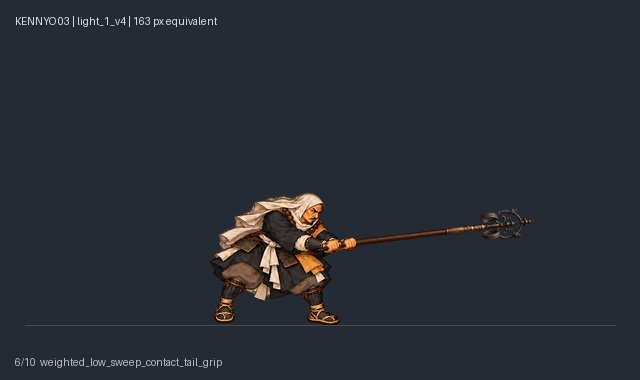 | 固定左腳支點、肩胸前下壓快速揮打，尾握接觸 [正常速度GIF](../deliveries/accepted-four-heroes-20261015/kennyo/source/review/light_1/normal.gif) · [metadata](../deliveries/accepted-four-heroes-20261015/kennyo/source/sources/light_1_v4/metadata.json) · [來源](../deliveries/accepted-four-heroes-20261015/kennyo/source/sources/light_1_v4) |
| `light_2` · accepted light_2_v3 | 7／680ms | 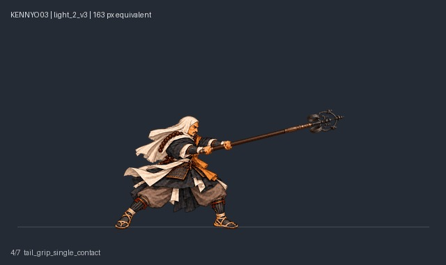 | 正常握持起手、單次右揮、最遠滑尾握、回正常guard [正常速度GIF](../deliveries/accepted-four-heroes-20261015/kennyo/source/review/light_2/normal.gif) · [metadata](../deliveries/accepted-four-heroes-20261015/kennyo/source/sources/light_2_v3/metadata.json) · [來源](../deliveries/accepted-four-heroes-20261015/kennyo/source/sources/light_2_v3) |
| `light_3` · accepted light_3_diagonal_fast_v3 | 11／950ms | 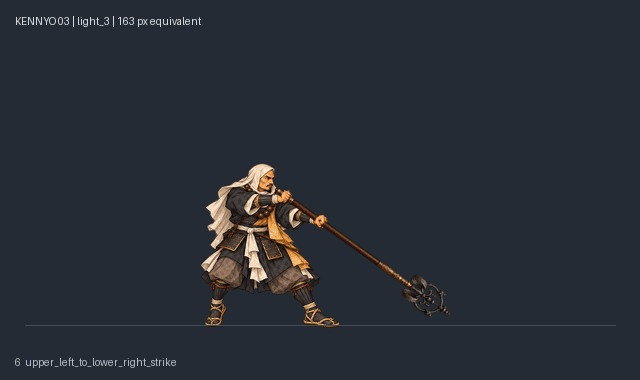 | 正面左上至右下快速斜掃；準備不變、下擊180→90ms [正常速度GIF](../deliveries/accepted-four-heroes-20261015/kennyo/source/review/light_3/normal.gif) · [metadata](../deliveries/accepted-four-heroes-20261015/kennyo/source/sources/light_3_diagonal_fast_v3/metadata.json) · [來源](../deliveries/accepted-four-heroes-20261015/kennyo/source/sources/light_3_diagonal_fast_v3) |
| `heavy` · accepted heavy | 8／1100ms | 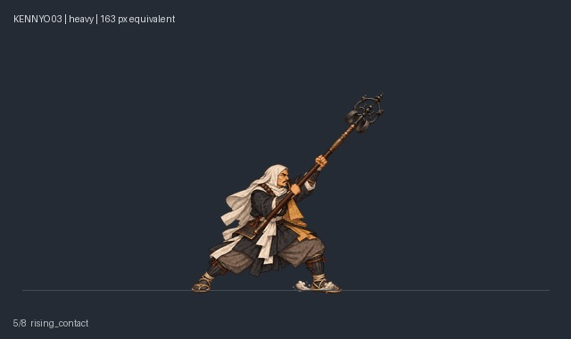 | 近身收杖、前進一步、由下往上重打 [正常速度GIF](../deliveries/accepted-four-heroes-20261015/kennyo/source/review/heavy/normal.gif) · [metadata](../deliveries/accepted-four-heroes-20261015/kennyo/source/sources/heavy/metadata.json) · [來源](../deliveries/accepted-four-heroes-20261015/kennyo/source/sources/heavy) |
| `charge_ready` · accepted charge_ready | 7／1600ms |  | 完整收杖至背後、合掌念經 [正常速度GIF](../deliveries/accepted-four-heroes-20261015/kennyo/source/review/charge_ready/normal.gif) · [metadata](../deliveries/accepted-four-heroes-20261015/kennyo/source/sources/charge_ready/stow-metadata.json) · [來源](../deliveries/accepted-four-heroes-20261015/kennyo/source/sources/charge_ready) |
| `charge_hold` · accepted charge_hold | 1／1000ms |  | 合掌靜止保持，人物不動 [正常速度GIF](../deliveries/accepted-four-heroes-20261015/kennyo/source/review/charge_hold/normal.gif) · [metadata](../deliveries/accepted-four-heroes-20261015/kennyo/source/sources/charge_hold/metadata.json) · [來源](../deliveries/accepted-four-heroes-20261015/kennyo/source/sources/charge_hold) |
| `charge_release` · accepted charge_release_v5 | 38／3170ms | 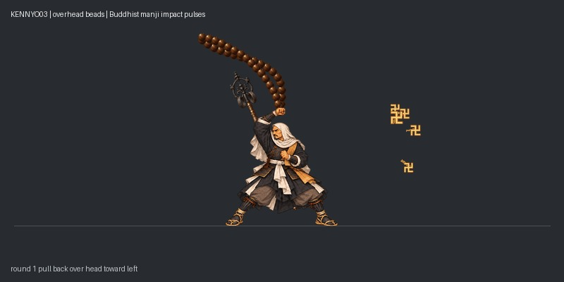 | 柔性念珠左拉越頭右甩三輪六擊，卍字向外與斜上不規則砸飛 [正常速度GIF](../deliveries/accepted-four-heroes-20261015/kennyo/source/review/charge_release/normal.gif) · [metadata](../deliveries/accepted-four-heroes-20261015/kennyo/source/sources/charge_release_v5/metadata.json) · [來源](../deliveries/accepted-four-heroes-20261015/kennyo/source/sources/charge_release_v5) |
| `air_light` · accepted air_light_continuous_11f_v3 | 11／770ms | 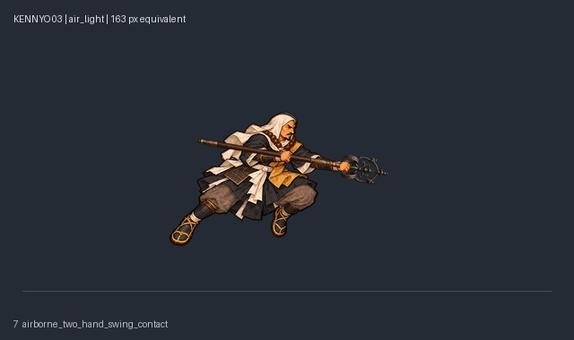 | 空中雙手連續同向揮弧，錫杖頭尾與前後遮擋連貫 [正常速度GIF](../deliveries/accepted-four-heroes-20261015/kennyo/source/review/air_light/normal.gif) · [metadata](../deliveries/accepted-four-heroes-20261015/kennyo/source/sources/air_light_continuous_11f_v3/metadata.json) · [來源](../deliveries/accepted-four-heroes-20261015/kennyo/source/sources/air_light_continuous_11f_v3) |
| `air_heavy` · accepted air_heavy_continuous_15f_v5 | 15／950ms | 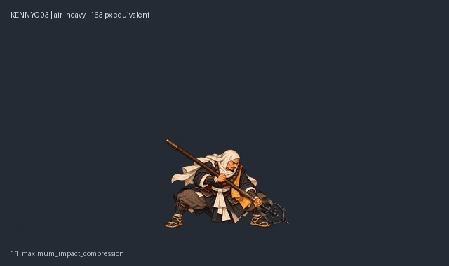 | 空重15格連貫修正：頭上蓄勢、漸開握距、穩定深蹲及收步；乾淨單次預覽 [正常速度GIF](../deliveries/accepted-four-heroes-20261015/kennyo/source/review/air_heavy/normal.gif) · [metadata](../deliveries/accepted-four-heroes-20261015/kennyo/source/sources/air_heavy_continuous_15f_v5/metadata.json) · [來源](../deliveries/accepted-four-heroes-20261015/kennyo/source/sources/air_heavy_continuous_15f_v5) |
| `grab_start` · accepted grabs/grab_start | 5／510ms | 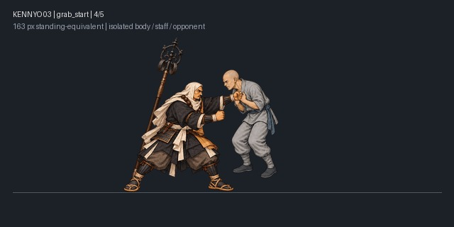 | 安全背收杖、抓領拉近 [正常速度GIF](../deliveries/accepted-four-heroes-20261015/kennyo/source/review/grab_start/normal.gif) · [metadata](../deliveries/accepted-four-heroes-20261015/kennyo/source/sources/grabs/grab_start/metadata.json) · [來源](../deliveries/accepted-four-heroes-20261015/kennyo/source/sources/grabs/grab_start) |
| `grab_hold` · accepted grabs/grab_hold | 1／800ms | 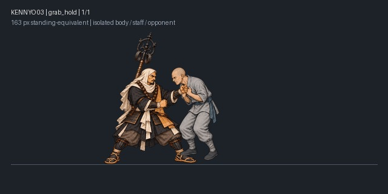 | 穩定抓取保持 [正常速度GIF](../deliveries/accepted-four-heroes-20261015/kennyo/source/review/grab_hold/normal.gif) · [metadata](../deliveries/accepted-four-heroes-20261015/kennyo/source/sources/grabs/grab_hold/metadata.json) · [來源](../deliveries/accepted-four-heroes-20261015/kennyo/source/sources/grabs/grab_hold) |
| `grab_hit_1` · accepted grabs/grab_hit_1 | 6／600ms | 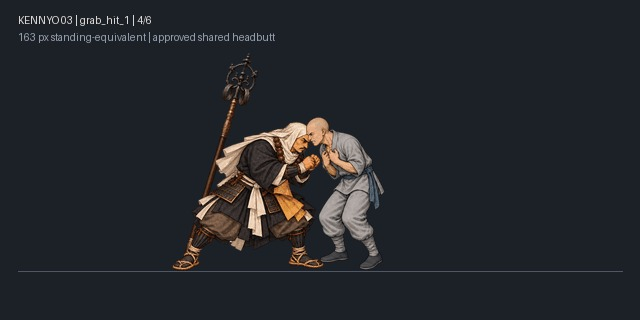 | 第一記頭槌，動作共用第二記、事件獨立 [正常速度GIF](../deliveries/accepted-four-heroes-20261015/kennyo/source/review/grab_hit_1/normal.gif) · [metadata](../deliveries/accepted-four-heroes-20261015/kennyo/source/sources/grabs/grab_hit_1/metadata.json) · [來源](../deliveries/accepted-four-heroes-20261015/kennyo/source/sources/grabs/grab_hit_1) |
| `grab_hit_2` · accepted grabs/grab_hit_2 | 6／600ms |  | 第二記獨立頭槌 [正常速度GIF](../deliveries/accepted-four-heroes-20261015/kennyo/source/review/grab_hit_2/normal.gif) · [metadata](../deliveries/accepted-four-heroes-20261015/kennyo/source/sources/grabs/grab_hit_2/metadata.json) · [來源](../deliveries/accepted-four-heroes-20261015/kennyo/source/sources/grabs/grab_hit_2) |
| `throw_forward` · accepted grabs/throw_forward | 12／980ms | 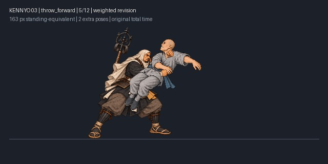 | 沉腰承重、抓緊抬起、蹬腿帶肩前拋 [正常速度GIF](../deliveries/accepted-four-heroes-20261015/kennyo/source/review/throw_forward/normal.gif) · [metadata](../deliveries/accepted-four-heroes-20261015/kennyo/source/sources/grabs/throw_forward/metadata.json) · [來源](../deliveries/accepted-four-heroes-20261015/kennyo/source/sources/grabs/throw_forward) |
| `throw_reverse` · accepted grabs/throw_reverse | 12／1030ms | 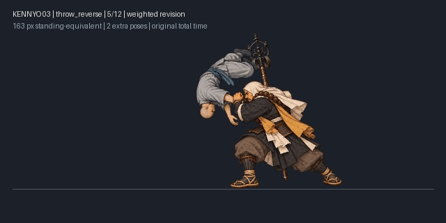 | 承重轉身上肩、反向過肩摔 [正常速度GIF](../deliveries/accepted-four-heroes-20261015/kennyo/source/review/throw_reverse/normal.gif) · [metadata](../deliveries/accepted-four-heroes-20261015/kennyo/source/sources/grabs/throw_reverse/metadata.json) · [來源](../deliveries/accepted-four-heroes-20261015/kennyo/source/sources/grabs/throw_reverse) |
| `dash_heavy` · accepted dash_heavy_thrust_v3 | 7／730ms | 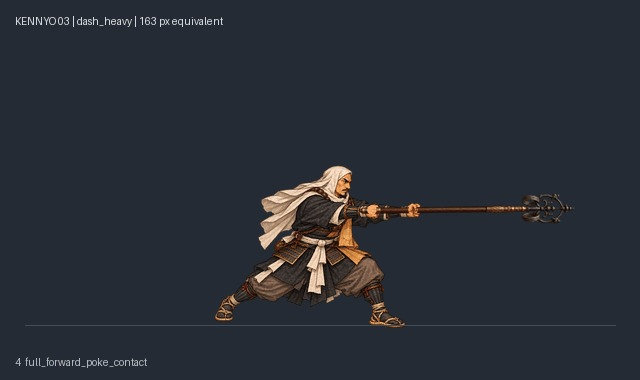 | 跑步末步、尾握前方長距離直戳、制動 [正常速度GIF](../deliveries/accepted-four-heroes-20261015/kennyo/source/review/dash_heavy/normal.gif) · [metadata](../deliveries/accepted-four-heroes-20261015/kennyo/source/sources/dash_heavy_thrust_v3/metadata.json) · [來源](../deliveries/accepted-four-heroes-20261015/kennyo/source/sources/dash_heavy_thrust_v3) |

## 重跑驗證

`python -X utf8 deliveries/accepted-four-heroes-20261015/verify_delivery.py` 驗9007檔來源SHA256、64招採用路徑與GIF時長、accepted狀態、版本鎖定及所有新增文件相對連結。[驗證結果](../deliveries/accepted-four-heroes-20261015/VALIDATION.json) 與 [來源SHA256清單](../deliveries/accepted-four-heroes-20261015/SOURCE_SHA256SUMS.json) 隨交付提供。
