# 阿市最終招式素材清單（2026-10-14）

本文件是本次交付的唯一選版索引，共17招。未提出意見的招式依使用者指示保留；已提出修改者採下表最新修訂。素材完成不等於遊戲程式已接入。

代表圖用於辨識姿勢；點開正常速度GIF檢查完整動作。時間是預覽調整值，正式判定、取消窗及遊戲tick由整合方映射。

| 招式 | 採用版本 | 播放格數 | 時長ms | 代表圖 | 說明 |
|---|---|---:|---:|---|---|
| light_1 輕攻擊第一段 | v2 | 8 | 840 | 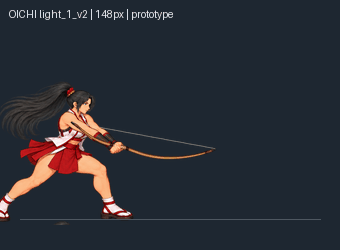 | 上舉蓄勢後向前下方大幅揮弓；前踏、擊中、收回共同待機。 [播放GIF](../../prototypes/oichi-final-20261014/docs/combat-art-reference/images/light_1.gif) |
| light_2 輕攻擊第二段 | v2 | 8 | 840 | 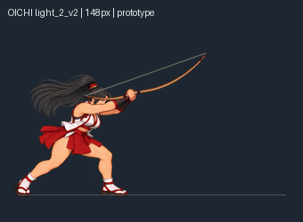 | 重新製作明確下擊，肩肘帶動弓身砸向前下方，避免像從後方拉回。 [播放GIF](../../prototypes/oichi-final-20261014/docs/combat-art-reference/images/light_2.gif) |
| light_3 輕攻擊第三段 | v3 force | 10 | 970 | 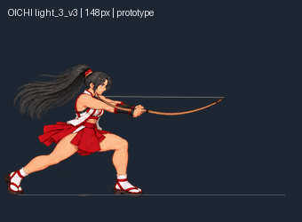 | 加重扭腰蓄勢、蹬地跨步與深弓步，肩臂伸展橫掃；接觸後擊飛，末格回共同待機。 [播放GIF](../../prototypes/oichi-final-20261014/docs/combat-art-reference/images/light_3.gif) |
| heavy 站立重射 | horizontal 9 keys | 9 | 800 | 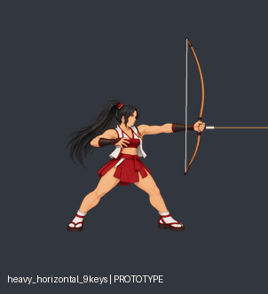 | 短拉弓後單箭水平射出；增加兩張有效過渡姿勢，保留回待機。 [播放GIF](../../prototypes/oichi-final-20261014/docs/combat-art-reference/images/heavy.gif) |
| charge_ready 蓄力拉弓 | v1 approved | 6 | 900 | 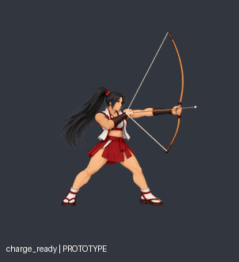 | 逐步舉弓、開肩拉弦至臉頰附近；雙腳固定支撐。 [播放GIF](../../prototypes/oichi-final-20261014/docs/combat-art-reference/images/charge_ready.gif) |
| charge_hold 滿蓄保持 | v1 approved | 3 | 760 | 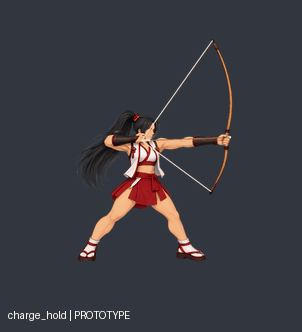 | 保持滿弓瞄準，少量呼吸循環；此段不發射。 [播放GIF](../../prototypes/oichi-final-20261014/docs/combat-art-reference/images/charge_hold.gif) |
| charge_release 蓄力貫穿箭 | horizontal | 5 | 660 | 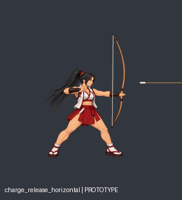 | 放弦後單箭水平貫穿；以實際碰撞處理擊退，無冰爆。 [播放GIF](../../prototypes/oichi-final-20261014/docs/combat-art-reference/images/charge_release.gif) |
| charge_rain 圓形箭雨 | radius1230 arrows70 | 10 | 1300 | 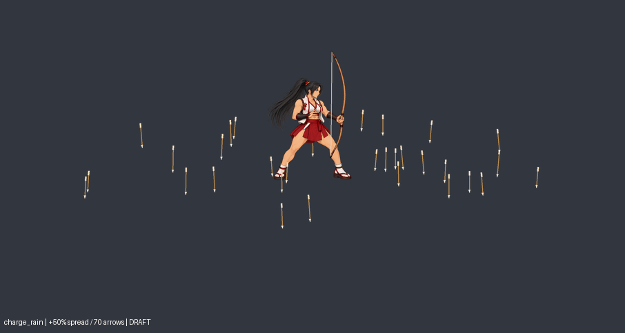 | 滿蓄蹲身、舉弓向空中射箭，箭離屏即啟動以阿市為中心的大圓形箭雨。70支隨機錯落落下，半徑1230來源座標單位；前後景分層。 [播放GIF](../../prototypes/oichi-final-20261014/docs/combat-art-reference/images/charge_rain.gif) |
| air_light 空中輕擊 | v2 deep downswing | 6 | 560 | 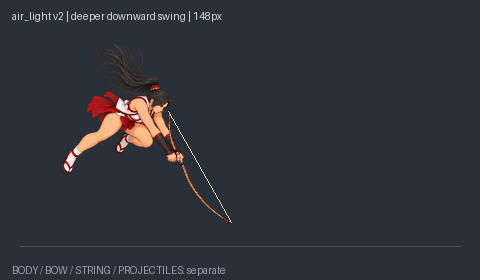 | 空中舉弓後更大幅向前下揮，接近地面敵人；此招是弓身近戰。 [播放GIF](../../prototypes/oichi-final-20261014/docs/combat-art-reference/images/air_light.gif) |
| air_heavy 空中三箭 | v3 shallow far | 6 | 740 | 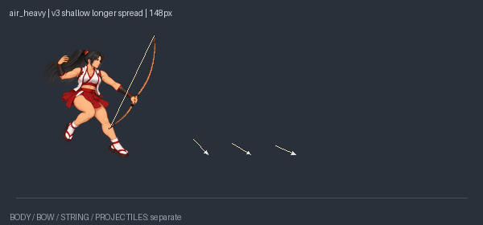 | 同時射出近、中、遠三支箭；角度較平、最遠射程加長。最新視覺方向取代早先平行／半畫面試案。 [播放GIF](../../prototypes/oichi-final-20261014/docs/combat-art-reference/images/air_heavy.gif) |
| dash_heavy 衝刺重擊 | v1 approved | 6 | 640 | 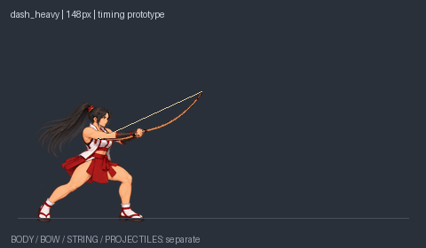 | 衝刺最後一步前踏，弓身大範圍掃擊後制動站穩；不蓄力、不射箭。 [播放GIF](../../prototypes/oichi-final-20261014/docs/combat-art-reference/images/dash_heavy.gif) |
| grab_start 抓取起手 | v1 approved | 6 | 680 | 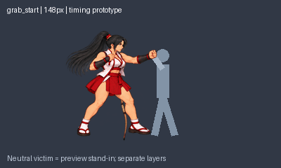 | 將弓收納側背，伸手抓住上臂或衣領，把目標拉近。 [播放GIF](../../prototypes/oichi-final-20261014/docs/combat-art-reference/images/grab_start.gif) |
| grab_hold 抓取保持 | v1 approved | 3 | 720 | 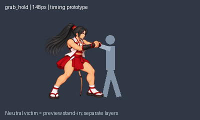 | 維持雙方抓取接點與距離，小幅準備膝擊。 [播放GIF](../../prototypes/oichi-final-20261014/docs/combat-art-reference/images/grab_hold.gif) |
| grab_hit_1 第一膝擊 | six keys | 6 | 420 | 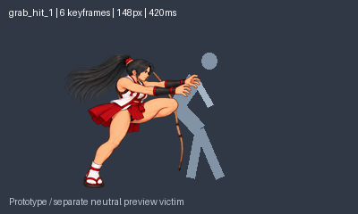 | 膝擊加入兩張過渡，共六格，190ms接觸，回到保持位置。 [播放GIF](../../prototypes/oichi-final-20261014/docs/combat-art-reference/images/grab_hit_1.gif) |
| grab_hit_2 第二膝擊 | v1 approved | 4 | 440 | 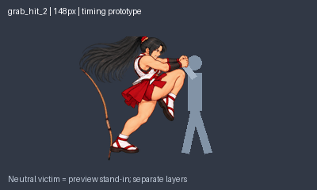 | 第二次獨立膝擊接觸，收回後準備轉髖。 [播放GIF](../../prototypes/oichi-final-20261014/docs/combat-art-reference/images/grab_hit_2.gif) |
| throw_forward 前摔 | edge cleaned | 8 | 900 | 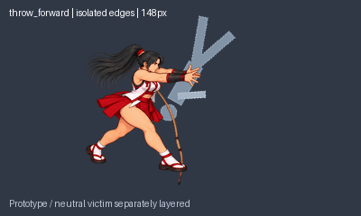 | 轉髖拉人後向前拋出，已清除鄰格多餘手部污染；目標軌跡獨立。 [播放GIF](../../prototypes/oichi-final-20261014/docs/combat-art-reference/images/throw_forward.gif) |
| throw_reverse 反向過肩摔 | registered slim13 | 13 | 960 | 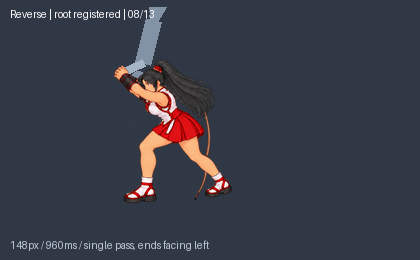 | 轉身、上肩、向後拋出；細腿版本保留，13格承重腳定位校正，580ms放手，結束面向左。 [播放GIF](../../prototypes/oichi-final-20261014/docs/combat-art-reference/images/throw_reverse.gif) |

## 每招圖層、接點及事件索引

### light_1 · 輕攻擊第一段

上舉蓄勢後向前下方大幅揮弓；前踏、擊中、收回共同待機。

- 素材：[assets/oichi/melee/light_1_v2](../../prototypes/oichi-final-20261014/assets/oichi/melee/light_1_v2)

- 每格接點、時長、來源與事件：[anchors_events.json](../../prototypes/oichi-final-20261014/assets/oichi/melee/light_1_v2/anchors_events.json)

- 原始JSON座標系及圖層尺寸依該招而定，禁止跨招套用一組裁切或縮放數值。

### light_2 · 輕攻擊第二段

重新製作明確下擊，肩肘帶動弓身砸向前下方，避免像從後方拉回。

- 素材：[assets/oichi/melee/light_2_v2](../../prototypes/oichi-final-20261014/assets/oichi/melee/light_2_v2)

- 每格接點、時長、來源與事件：[anchors_events.json](../../prototypes/oichi-final-20261014/assets/oichi/melee/light_2_v2/anchors_events.json)

- 原始JSON座標系及圖層尺寸依該招而定，禁止跨招套用一組裁切或縮放數值。

### light_3 · 輕攻擊第三段

加重扭腰蓄勢、蹬地跨步與深弓步，肩臂伸展橫掃；接觸後擊飛，末格回共同待機。

- 素材：[assets/oichi/melee/light_3_v3](../../prototypes/oichi-final-20261014/assets/oichi/melee/light_3_v3)

- 每格接點、時長、來源與事件：[anchors_events.json](../../prototypes/oichi-final-20261014/assets/oichi/melee/light_3_v3/anchors_events.json)

- 原始JSON座標系及圖層尺寸依該招而定，禁止跨招套用一組裁切或縮放數值。

### heavy · 站立重射

短拉弓後單箭水平射出；增加兩張有效過渡姿勢，保留回待機。

- 素材：[assets/oichi/arrows/heavy_package/heavy_horizontal_9keys](../../prototypes/oichi-final-20261014/assets/oichi/arrows/heavy_package/heavy_horizontal_9keys)

- 每格接點、時長、來源與事件：[animation.json](../../prototypes/oichi-final-20261014/assets/oichi/arrows/heavy_package/heavy_horizontal_9keys/animation.json)

- 原始JSON座標系及圖層尺寸依該招而定，禁止跨招套用一組裁切或縮放數值。

### charge_ready · 蓄力拉弓

逐步舉弓、開肩拉弦至臉頰附近；雙腳固定支撐。

- 素材：[assets/oichi/arrows/charge_ready](../../prototypes/oichi-final-20261014/assets/oichi/arrows/charge_ready)

- 每格接點、時長、來源與事件：[animation.json](../../prototypes/oichi-final-20261014/assets/oichi/arrows/charge_ready/animation.json)

- 原始JSON座標系及圖層尺寸依該招而定，禁止跨招套用一組裁切或縮放數值。

### charge_hold · 滿蓄保持

保持滿弓瞄準，少量呼吸循環；此段不發射。

- 素材：[assets/oichi/arrows/charge_hold](../../prototypes/oichi-final-20261014/assets/oichi/arrows/charge_hold)

- 每格接點、時長、來源與事件：[animation.json](../../prototypes/oichi-final-20261014/assets/oichi/arrows/charge_hold/animation.json)

- 原始JSON座標系及圖層尺寸依該招而定，禁止跨招套用一組裁切或縮放數值。

### charge_release · 蓄力貫穿箭

放弦後單箭水平貫穿；以實際碰撞處理擊退，無冰爆。

- 素材：[assets/oichi/arrows/release_package/charge_release_horizontal](../../prototypes/oichi-final-20261014/assets/oichi/arrows/release_package/charge_release_horizontal)

- 每格接點、時長、來源與事件：[animation.json](../../prototypes/oichi-final-20261014/assets/oichi/arrows/release_package/charge_release_horizontal/animation.json)

- 原始JSON座標系及圖層尺寸依該招而定，禁止跨招套用一組裁切或縮放數值。

### charge_rain · 圓形箭雨

滿蓄蹲身、舉弓向空中射箭，箭離屏即啟動以阿市為中心的大圓形箭雨。70支隨機錯落落下，半徑1230來源座標單位；前後景分層。

- 素材：[assets/oichi/arrows/rain_package/charge_rain](../../prototypes/oichi-final-20261014/assets/oichi/arrows/rain_package/charge_rain)

- 每格接點、時長、來源與事件：[animation.json](../../prototypes/oichi-final-20261014/assets/oichi/arrows/rain_package/charge_rain/animation.json)

- 原始JSON座標系及圖層尺寸依該招而定，禁止跨招套用一組裁切或縮放數值。

### air_light · 空中輕擊

空中舉弓後更大幅向前下揮，接近地面敵人；此招是弓身近戰。

- 素材：[assets/oichi/oichi_air_light_v2/air_light](../../prototypes/oichi-final-20261014/assets/oichi/oichi_air_light_v2/air_light)

- 每格接點、時長、來源與事件：[anchors_events.json](../../prototypes/oichi-final-20261014/assets/oichi/oichi_air_light_v2/air_light/anchors_events.json)

- 原始JSON座標系及圖層尺寸依該招而定，禁止跨招套用一組裁切或縮放數值。

### air_heavy · 空中三箭

同時射出近、中、遠三支箭；角度較平、最遠射程加長。最新視覺方向取代早先平行／半畫面試案。

- 素材：[assets/oichi/oichi_air_heavy_v3/air_heavy](../../prototypes/oichi-final-20261014/assets/oichi/oichi_air_heavy_v3/air_heavy)

- 每格接點、時長、來源與事件：[anchors_events.json](../../prototypes/oichi-final-20261014/assets/oichi/oichi_air_heavy_v3/air_heavy/anchors_events.json)

- 原始JSON座標系及圖層尺寸依該招而定，禁止跨招套用一組裁切或縮放數值。

### dash_heavy · 衝刺重擊

衝刺最後一步前踏，弓身大範圍掃擊後制動站穩；不蓄力、不射箭。

- 素材：[assets/oichi/dash/dash_heavy](../../prototypes/oichi-final-20261014/assets/oichi/dash/dash_heavy)

- 每格接點、時長、來源與事件：[anchors_events.json](../../prototypes/oichi-final-20261014/assets/oichi/dash/dash_heavy/anchors_events.json)

- 原始JSON座標系及圖層尺寸依該招而定，禁止跨招套用一組裁切或縮放數值。

### grab_start · 抓取起手

將弓收納側背，伸手抓住上臂或衣領，把目標拉近。

- 素材：[assets/oichi/grabs](../../prototypes/oichi-final-20261014/assets/oichi/grabs)

- 每格接點、時長、來源與事件：[grab_start.json](../../prototypes/oichi-final-20261014/assets/oichi/grabs/grab_start.json)

- 原始JSON座標系及圖層尺寸依該招而定，禁止跨招套用一組裁切或縮放數值。

### grab_hold · 抓取保持

維持雙方抓取接點與距離，小幅準備膝擊。

- 素材：[assets/oichi/grabs](../../prototypes/oichi-final-20261014/assets/oichi/grabs)

- 每格接點、時長、來源與事件：[grab_hold.json](../../prototypes/oichi-final-20261014/assets/oichi/grabs/grab_hold.json)

- 原始JSON座標系及圖層尺寸依該招而定，禁止跨招套用一組裁切或縮放數值。

### grab_hit_1 · 第一膝擊

膝擊加入兩張過渡，共六格，190ms接觸，回到保持位置。

- 素材：[assets/oichi/grabs/grab_hit_1_six](../../prototypes/oichi-final-20261014/assets/oichi/grabs/grab_hit_1_six)

- 每格接點、時長、來源與事件：[metadata.json](../../prototypes/oichi-final-20261014/assets/oichi/grabs/grab_hit_1_six/metadata.json)

- 原始JSON座標系及圖層尺寸依該招而定，禁止跨招套用一組裁切或縮放數值。

### grab_hit_2 · 第二膝擊

第二次獨立膝擊接觸，收回後準備轉髖。

- 素材：[assets/oichi/grabs](../../prototypes/oichi-final-20261014/assets/oichi/grabs)

- 每格接點、時長、來源與事件：[grab_hit_2.json](../../prototypes/oichi-final-20261014/assets/oichi/grabs/grab_hit_2.json)

- 原始JSON座標系及圖層尺寸依該招而定，禁止跨招套用一組裁切或縮放數值。

### throw_forward · 前摔

轉髖拉人後向前拋出，已清除鄰格多餘手部污染；目標軌跡獨立。

- 素材：[assets/oichi/grabs/throw_fixes](../../prototypes/oichi-final-20261014/assets/oichi/grabs/throw_fixes)

- 每格接點、時長、來源與事件：[throw_forward_metadata.json](../../prototypes/oichi-final-20261014/assets/oichi/grabs/throw_fixes/throw_forward_metadata.json)

- 原始JSON座標系及圖層尺寸依該招而定，禁止跨招套用一組裁切或縮放數值。

### throw_reverse · 反向過肩摔

轉身、上肩、向後拋出；細腿版本保留，13格承重腳定位校正，580ms放手，結束面向左。

- 素材：[assets/oichi/grabs/reverse_coherent](../../prototypes/oichi-final-20261014/assets/oichi/grabs/reverse_coherent)

- 每格接點、時長、來源與事件：[registered_metadata.json](../../prototypes/oichi-final-20261014/assets/oichi/grabs/reverse_coherent/registered_metadata.json)

- 原始JSON座標系及圖層尺寸依該招而定，禁止跨招套用一組裁切或縮放數值。

## 整合注意

- 人物、弓、弦、箭、箭雨及被摔目標分層；preview/composite/GIF僅展示，不作正式人物貼圖。

- 武器角度和握持點按各招JSON使用；近戰輔助手不能當拉弦手。

- 箭雨採最新 rain_circle_sparse_fx/circle_rain_events.json：半徑1230、70支、人物大小不變，不能再套舊半徑410或820。

- 反摔採 registered_metadata.json / stable_body_* / stable_victim_* / stable_weapon_*；final_metadata.json 是重建中間資料，不可當最終入口。

- 舊版六格sampler須改成依每格duration播放，不得強制截成六格。反摔單次播放，末尾銜接左向idle；抓取保持和滿蓄保持才是循環。

- 詳見 [交接文件](../HANDOFF-OICHI-FINAL-20261014.md)。

[返回阿市招式文件](characters/oichi.md) · [素材入口](README.md) · [採用manifest](../../prototypes/oichi-final-20261014/ACTION_MANIFEST.json)
